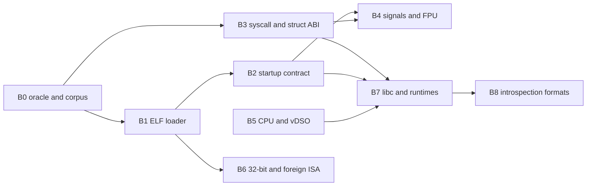

# AzamiOS Binary Compatibility Plan (for Codex)

> **Date:** 2026-10-11. **Extends:** [`USERSPACE_IMPROVEMENT_PLAN.md`](USERSPACE_IMPROVEMENT_PLAN.md) (U0–U7) and [`USERSPACE_STATIC_RECOMP_LINUX_PLAN.md`](USERSPACE_STATIC_RECOMP_LINUX_PLAN.md) (U8–U10). Task IDs continue as **B0–B8**.
> **Scope:** everything that decides whether a binary built elsewhere (Linux x86-64 first, then other formats/ISAs) runs *unmodified*: executable formats, process-startup contract, syscall/struct/ioctl ABI, signal frames, vDSO, CPU features, `/proc`+`/sys` text formats, and the tests that prove it.
> **Standard (`AGENTS.md`):** complete implementations only. An unsupported binary must be rejected with the precise Linux errno (`ENOEXEC`, `ENOENT` for missing interpreter, `E2BIG`, …), never run with silently wrong semantics. Never touch `hdd.img`.
> Skills to read per workstream are listed under each heading (`.agents/skills/<name>/SKILL.md`).

---

## 0. Baseline (audited 2026-10-11)

| Area | Verified in source | Gap |
| :--- | :--- | :--- |
| Executable formats `kernel/sched/elf.c` | ELF `ET_EXEC`/`ET_DYN` (`:437`), `#!` scripts (`:482`), `PT_INTERP` (strict, no libc substitution, `:598`), `PT_PHDR`, `PT_GNU_STACK` (`:283`), ASLR bias for `ET_DYN` (`:559`) | Needs verification: `e_machine`/`e_ident` class+data+OSABI checks, `PT_GNU_PROPERTY` (CET/IBT/SHSTK), `PT_GNU_RELRO`/`PT_TLS` ignored safely, overlapping/huge/unaligned segments, `p_align` > page, `e_phnum` limits, interpreter that is itself a script. No `binfmt_misc`, no `a.out`, no 32-bit ELF |
| Auxv `elf.c:162-187` | `AT_PHDR/PHENT/PHNUM/PAGESZ/BASE/FLAGS/ENTRY/UID/EUID/GID/EGID/HWCAP/HWCAP2/CLKTCK/SECURE/RANDOM/EXECFN/PLATFORM/SYSINFO_EHDR` | Missing vs. Linux 6.x x86-64: `AT_MINSIGSTKSZ` (51, glibc ≥ 2.34 sizes signal stacks from it), `AT_BASE_PLATFORM`, `AT_RSEQ_FEATURE_SIZE`/`AT_RSEQ_ALIGN` (glibc ≥ 2.35), `AT_HWCAP3/4`, `AT_SYSINFO` n/a on x86-64. `AT_SECURE` hard-wired 0: setuid/setgid/file-caps exec must set it |
| Syscall ABI | 385 numbers, 356 implemented, 29 `ENOSYS`; table-generated (`syscalls.tbl`); canonical uapi headers guarded by `scripts/check_uapi_sync.sh` | `ENOSYS` correctness: Linux returns `-ENOSYS` for **unknown numbers** and `-ENOSYS` for stubs, which the stubs honour; need proof that every *implemented* syscall matches Linux struct layout/flag validation (`EINVAL` on unknown flag bits) — the biggest silent-incompat source |
| 32-bit (`int 0x80`, `syscall` from compat mode) | No `ia32`/`EM_386`/`ELFCLASS32` handling found in `kernel/sched` or `arch/x86_64/syscall` | i386 binaries unsupported (correctly rejected?) — must be verified and, if desired, implemented (B6) |
| vsyscall page (`0xffffffffff600000`) | none found | Only matters for very old static glibc (< 2.14); deliberately emulate-or-fault, decide in B3 |
| Signals `kernel/signal.c` | `rt_sigaction/procmask/sigaltstack`, `rt_sigreturn` | Need byte-exact `struct rt_sigframe` / `ucontext_t` / `siginfo_t` / `_fpstate` (xsave) layout and `SA_RESTORER` semantics; `MINSIGSTKSZ` must match `AT_MINSIGSTKSZ` |
| Test evidence | `abi-probe` 121/121, many `azami-*-probe`, boot matrix, busybox smoke | No golden-struct tests, no ELF-loader negative corpus, no cross-libc matrix (musl static/dynamic, glibc, Go, Rust, Bionic-less), no `strace` differential (U0.2) |

> [!IMPORTANT]
> Success is defined by **running real third-party binaries and diffing against real Linux**, not by self-written probes agreeing with the kernel. Every B-task adds at least one third-party or host-generated oracle.

---

## B0. Oracle and Corpus (do first)

**Skills:** `strace-ltrace`, `elf-inspection`, `qemu-for-kernel-development`, `kernel-testing`

1. **Binary corpus `tests/compat/corpus/`**, each entry with source URL, SHA-256, license, build recipe, expected outcome (`pass`, `reject:<errno>`):
   - musl static, musl static-PIE, musl dynamic
   - Go (`CGO_ENABLED=0`), Rust (`musl`, `crt-static`), Zig (`-target x86_64-linux-musl`)
   - Debian/glibc dynamic (`ls`, `python3`), glibc static (expected to be partially unsupported → recorded)
   - Alpine `busybox`, `apk.static`
   - Intentionally malformed ELFs (B1.3)
2. **Oracle = real Linux** (host or `qemu-system-x86_64 -enable-kvm` with a stock kernel): the harness runs each corpus entry on both, normalises (addresses, pids, times, `AT_RANDOM`-dependent bytes) and compares stdout, exit status, and the `strace -f -yy` syscall/errno sequence (reuses U0.2).
3. **Result matrix** auto-generated into `docs/BINARY_COMPAT_STATUS.md` (`corpus entry × {pass, diff, reject-correct, FAIL}`), never hand-edited. Gate 3 (U0.1) fails on any `pass → FAIL` regression.
4. **Linux version pinning:** record the oracle kernel version (target **6.6 LTS** ABI for numbering/flags; document deviations).

---

## B1. ELF Loader Strictness and Completeness

**Skills:** `elf-inspection`, `linux-kernel-architecture`, `kernel-security`, `fuzzing`

| # | Task | Details | Verify |
| :- | :--- | :--- | :--- |
| B1.1 | Header validation | Reject (`ENOEXEC`) bad `e_ident` magic/class/data/version, `e_machine != EM_X86_64`, `e_type` not `EXEC/DYN`, `e_phentsize != sizeof(Elf64_Phdr)`, `e_phnum == 0` or `> 65535/…` Linux limit, phdr table outside file (`ENOEXEC`), `p_filesz > p_memsz`, `p_offset % PAGE != p_vaddr % PAGE`, segments overlapping or wrapping the address space, kernel-range addresses (`EINVAL`/`ENOEXEC` as Linux). Accept `ELFOSABI_NONE/GNU` | Malformed-ELF corpus of ≥ 40 files each with its expected errno, verified against the host kernel; none may crash/hang the kernel |
| B1.2 | Segment semantics | `p_align > PAGE_SIZE` honoured for `ET_DYN` bias; `p_memsz > p_filesz` zero-fills the partial page tail and maps anonymous pages; `PT_GNU_STACK` flags control stack exec (default non-exec); `PT_TLS` and `PT_GNU_RELRO` accepted and ignored by the kernel; `PT_NOTE`/`PT_GNU_PROPERTY` parsed (store CET/BTI flags for later); `brk` placed after the highest segment end with randomisation; huge BSS | Linux-built test binaries with each construct; `/proc/self/maps` matches host layout shape (permissions/order) |
| B1.3 | Interpreter rules | `PT_INTERP` length/NUL/`PATH_MAX` limits; interpreter must be `ET_DYN` or `ET_EXEC` ELF with the same machine; no interpreter chain (interpreter that is a script → `ELIBBAD`); `ENOENT` with the real missing path when absent; `AT_BASE` and `AT_ENTRY`/`AT_PHDR` correct for both PIE and non-PIE | Probe matrix; kept strictness: never substitute another libc (existing rule) |
| B1.4 | Script and `binfmt_misc` | `#!` rules identical to Linux (255-byte line limit, single optional argument, leading whitespace, recursion depth 4 → `ELOOP`, `argv[0]` becoming script path, `AT_EXECFN`, `O_CLOEXEC` interplay `fexecve` of script → `ENOENT`). Implement `binfmt_misc` (register by magic/extension, flags `P O C F`) via `/proc/sys/fs/binfmt_misc` — required by `qemu-user` (U10.4) and container tooling | `register` a test handler, exec a matching file; Linux-ground-truth tests from LTP `execve*` |
| B1.5 | `execve` ABI edge cases | `argv/envp` size limits (`ARG_MAX` = ¼ stack rlimit, `MAX_ARG_STRLEN` = 128 KiB per string → `E2BIG`), `NULL` argv accepted with Linux's warning semantics, `AT_SECURE` for set-id/file-cap exec with `LD_*` scrubbing contract, close-on-exec, signal disposition reset, `PR_SET_NO_NEW_PRIVS`, `exec` from a multi-threaded process (other threads killed, leader id kept), `vfork`+`exec` | Reuse `azami-exec-probe`; add the cases; diff vs host |
| B1.6 | Fuzz the loader | Host harness (libFuzzer, ASan/UBSan) compiling `kernel/sched/elf.c` parsing logic with a mock VMM; seed with corpus; any crash becomes a regression file in `tests/compat/malformed/` (aligns with `IMPROVEMENT_PLAN.md` W5.1) | 10 minutes clean run in the gate; found bugs fixed |

---

## B2. Process Startup Contract (stack, auxv, registers)

**Skills:** `abi-and-calling-conventions`, `assembly-x86`, `dynamic-linking`

| # | Task | Details | Verify |
| :- | :--- | :--- | :--- |
| B2.1 | Complete auxv | Add `AT_MINSIGSTKSZ` (value from the xsave area size: `CPUID.0xD` + signal frame overhead, same formula as Linux), `AT_BASE_PLATFORM` (`"x86_64"`), `AT_RSEQ_FEATURE_SIZE`/`AT_RSEQ_ALIGN` once `rseq` exists (U6 P0), `AT_HWCAP3/4` = 0, `AT_EXECFD` never emitted, `AT_SECURE` computed from exec credentials; `AT_HWCAP` must stay `CPUID.1.EDX`; `AT_HWCAP2` mirrors Linux bits (e.g. `HWCAP2_RING3MWAIT`, `FSGSBASE`) | `getauxval` dump of every type compared against a Linux host on the same CPU class; unknown types must be absent, not zero-valued |
| B2.2 | Initial stack layout | 16-byte aligned `%rsp` at `_start`, order `argc, argv[], NULL, envp[], NULL, auxv[], …, padding, AT_RANDOM bytes, platform string, execfn, strings`; initial register state: all general registers zero except `%rsp`, `%rdx` = 0 (static) or the `atexit` handler pointer as the psABI allows (document), `RFLAGS` = `0x202`, x87/SSE/AVX state reset, `MXCSR` = `0x1f80`, `FCW` = `0x37f`, `%fs`/`%gs` base 0 | Assembly probe prints registers at entry; compared with host |
| B2.3 | Randomisation | Independent entropy for stack, `mmap` base, `brk`, PIE bias, interpreter bias, vDSO; `personality(ADDR_NO_RANDOMIZE)` and `/proc/sys/kernel/randomize_va_space` (0/1/2) honoured; 64-exec distinct-base test (shared with U5.2) | Entropy bits ≥ Linux's x86-64 defaults (28 bits mmap, 22 bits stack) measured |
| B2.4 | Rlimits and personalities | Initial `RLIMIT_STACK` = 8 MiB with grow-down semantics up to the limit; `RLIMIT_*` defaults match Linux (`NOFILE` 1024 soft, `CORE` 0, …) and are inherited; `personality(2)` flags that musl/glibc query (`PER_LINUX`, `READ_IMPLIES_EXEC` only if `PT_GNU_STACK` absent) | Probe values vs host |
| B2.5 | TLS and thread pointer | `arch_prctl(ARCH_SET_FS/GET_FS/SET_GS/GET_GS)`, `FSGSBASE` instructions enabled only when CR4.FSGSBASE is set and reported in `AT_HWCAP2`, `set_tid_address`, `clone` `CLONE_SETTLS` | Go runtime (uses `%fs`/`arch_prctl` heavily) passes, plus glibc `pthread` tests |

---

## B3. Syscall, Structure and ioctl ABI Exactness

**Skills:** `linux-kernel-architecture`, `kernel-internals`, `kernel-testing`, `strace-ltrace`

| # | Task | Details | Verify |
| :- | :--- | :--- | :--- |
| B3.1 | Golden struct layouts | Generate C `static_assert`/`_Static_assert` size+offset checks for every user-visible struct from the **Linux 6.6 uapi headers** (`stat`, `statx`, `timespec`, `itimerspec`, `sigaction`, `siginfo_t`, `ucontext_t`, `rlimit64`, `rusage`, `sysinfo`, `utsname`, `epoll_event` (packed on x86-64!), `iovec`, `msghdr`, `cmsghdr`, `sockaddr_*`, `dirent64`, `flock`, `statfs`, `termios/termios2`, `winsize`, `ifreq`, `perf_event_attr` incl. all `PERF_ATTR_SIZE_VER*`, `clone_args`, `open_how`, `io_uring_*`, `rseq`, `seccomp_data`, `user_regs_struct`, `user_fpregs_struct`, `msqid_ds/semid64_ds/shmid64_ds`). Generate offsets once from the host with `pahole`/`offsetof` into `tests/compat/layouts.h`; the kernel and abi-probe both include it | Build fails if any layout diverges; list of structs auto-extracted from `kernel/syscall/syscalls.tbl` argument types |
| B3.2 | Flag validation sweep | For every syscall, enumerate the flag/argument bits Linux defines. Unknown bits must give `-EINVAL` (or `-EOPNOTSUPP` where Linux does); known-but-unsupported bits must give an honest error rather than success. Auto-generate a probe that passes each *undefined* bit separately and compares the return with the host kernel (differential `ENOSYS`/`EINVAL` mapping table `tests/compat/errno_matrix.tsv`) | Zero divergences, or each divergence is listed with reason and tracked in `docs/BINARY_COMPAT_STATUS.md` |
| B3.3 | Extensible-struct protocol | `openat2`, `clone3`, `sched_setattr`, `perf_event_open`, `bpf` (when added), `landlock`, `mount_setattr`: implement `copy_struct_from_user` semantics exactly — older/smaller structs OK, larger structs allowed **only if the tail is zero** else `E2BIG`, size too small → `EINVAL` | Probe with size = min−1, min, min+8 (zero tail), min+8 (non-zero tail) per syscall |
| B3.4 | Errno and return-value conventions | Error returns in `-4095..-1`; `ERESTARTSYS`/`ERESTARTNOHAND`/`ERESTART_RESTARTBLOCK` are never visible to userspace; syscall restart after signal re-enters with `%rip -= 2`; `EINTR` vs restart per `SA_RESTART` for every blocking call (`read/write/accept/connect/recv*/send*/futex/epoll_wait/poll/select/nanosleep/clock_nanosleep/wait4`) | Table-driven signal-interruption probe |
| B3.5 | Register preservation | Syscall clobbers only `%rax`, `%rcx`, `%r11` (already checked); also preserves `%rdi/%rsi/%rdx/%r8/%r9/%r10`, FP/SIMD state, `RFLAGS.DF` cleared on entry; `syscall` return via `sysret` canonical-address check vs `iretq` fallback (avoid the CVE-2012-0217 class) | Extend the inline-asm register probe to XMM/YMM/x87 state |
| B3.6 | ioctl database | Maintain `tests/compat/ioctl.tsv` (`request, dir, size, type, fd-kind, expected-errno-on-wrong-fd`). Implemented ioctls must use the Linux request encoding (`_IOC`), return `ENOTTY` (not `EINVAL`) for unsupported requests, and `EFAULT` on bad user pointers. Cover `TCGETS/TCSETS*`, `TIOCGWINSZ`, `TIOCSCTTY`, `TIOCGPGRP`, `FIONREAD`, `FIONBIO`, `FIOCLEX`, `SIOCGIF*`, `BLK*`, `FS_IOC_*`, `EVIOC*`, `DRM_IOCTL_*`, `SNDRV_*` | Probe walks the table; fuzz with random request numbers to prove no panics |
| B3.7 | Pointer validation | Every `copy_from/to_user` must return `-EFAULT` for kernel addresses, unmapped, `PROT_NONE`, and non-canonical pointers; partial writes (short read/write counts) behave as Linux; `-EFAULT` for `readv` with one bad iovec after some data returns the byte count first | Fault-injection probe with a guard-page layout |
| B3.8 | vsyscall decision | Linux ≥ 5.x defaults to `vsyscall=xonly`. Implement the same (page at `0xffffffffff600000` executable-only that traps → emulate `gettimeofday/time/getcpu`), or leave unmapped so old static glibc takes `SIGSEGV`. Record the choice in `docs/BINARY_COMPAT_STATUS.md` | Test binary calling the legacy entry |

---

## B4. Signal, Context and Floating-Point ABI

**Skills:** `abi-and-calling-conventions`, `assembly-x86`, `kernel-concurrency`

| # | Task | Details | Verify |
| :- | :--- | :--- | :--- |
| B4.1 | Signal frame | Build `struct rt_sigframe` exactly as Linux x86-64: `pretcode` at the frame top, `ucontext` with `uc_mcontext` (`gregs[23]`, `fpstate` pointer), `siginfo`, 64-byte red-zone skip (`128 B`), 16-byte alignment (`(rsp+8) % 16 == 0` at handler entry), XSAVE area with `FP_XSTATE_MAGIC1/2` and `fx_sw_reserved` so `AT_MINSIGSTKSZ` is truthful | Handler dumps frame fields; compared with the host for the same program (modulo addresses/`gregs[REG_RIP]`) |
| B4.2 | `rt_sigreturn` robustness | Validate user-modified `uc_mcontext`: reject non-canonical `RIP`, invalid `CS/SS`, `RFLAGS` privileged bits masked (IOPL/IF forced); bad frame ⇒ `SIGSEGV` to the thread (never kernel crash) | Malicious-frame tests; kernel keeps running |
| B4.3 | `SA_*` flags | `SA_SIGINFO`, `SA_RESTORER` (required on x86-64; musl/glibc supply it), `SA_ONSTACK`+`sigaltstack` (`MINSIGSTKSZ`, `SS_ONSTACK`, `SS_DISABLE`, `SS_AUTODISARM`), `SA_NODEFER`, `SA_RESETHAND`, `SA_RESTART`, `SA_NOCLDSTOP/NOCLDWAIT`, `SA_EXPOSE_TAGBITS` rejected honestly | Per-flag probe + LTP `sigaction*` tests |
| B4.4 | Signals × threads/fork/exec | Per-thread masks and pending, process-directed delivery choice, `tgkill/tkill`, `sigqueueinfo`, `SIGCHLD` `si_code/si_status/si_pid/si_uid`, `SIGSEGV` `si_addr`/`si_code` (`SEGV_MAPERR/ACCERR`), `SIGBUS` on truncated mmap, `SIGFPE` `FPE_INTDIV`, real-time signal queueing order and `SIGRTMIN` values (34 Linux kernel / glibc reserves 2) | Probe matrix; Go runtime (heavy signal user: preemption via `SIGURG`) stress |
| B4.5 | FPU/SIMD state | Lazy vs eager save consistent across context switch/signal; `MXCSR`/`FCW` inheritance on `clone`; AVX/AVX-512/AMX permissions via `arch_prctl(ARCH_REQ_XCOMP_PERM)` (`U6`); `XSAVEC`/`XSAVES` supervisor state not leaked to user; deterministic mask of unsupported `XCR0` bits | Differential FP-state probe (including denormals) vs host |
| B4.6 | Ptrace register ABI | `PTRACE_GETREGS/GETFPREGS/GETREGSET (NT_PRSTATUS, NT_PRFPREG, NT_X86_XSTATE)`, `struct user_regs_struct` layout, `orig_rax`, `syscall-exit-stop` `rax` = `-ENOSYS` at entry; consumed by `strace` and `gdb` (U7) | strace output of a corpus binary equal to host `strace` modulo timing |

---

## B5. CPU Features and vDSO Contract

**Skills:** `assembly-x86`, `simd-intrinsics`, `hypervisor-internals`, `kernel-internals`

1. **CPUID policy table** `docs/CPU_FEATURES.md`: for every feature bit user binaries probe (SSE4.2, AVX, AVX2, BMI1/2, ERMS, FSRM, AVX-512 subsets, AMX, `RDRAND/RDSEED`, `XSAVEC`, `FSGSBASE`, `SHA`, `ADX`, `PCLMULQDQ`, `AES-NI`), define *advertised iff* OS support is enabled in `CR4/XCR0`. Provide a **mask** boot parameter (`clearcpuid=`, documented in `KERNEL-PARAMETERS.md`) and expose identical flags in `/proc/cpuinfo` and `AT_HWCAP`.
2. **Instruction faults:** `UD2`, `INT3` (`SIGTRAP` `TRAP_BRKPT`), `HLT`/`IN/OUT`/`MOV CR` (`SIGSEGV`, `SI_KERNEL`), `RDTSC`/`RDPID` allowed, `CPUID` faulting via `arch_prctl(ARCH_SET_CPUID)` (U6), `SYSENTER`/`SYSCALL` from 32-bit rejected, `UMIP` emulation or enable CR4.UMIP.
3. **vDSO contract:** `AT_SYSINFO_EHDR` ELF is a valid `ET_DYN` with `DT_HASH` **and** `DT_GNU_HASH`, `PT_LOAD` + `PT_DYNAMIC`, symbol versions `LINUX_2.6`, exports `__vdso_clock_gettime`, `__vdso_gettimeofday`, `__vdso_time`, `__vdso_getcpu`, `__vdso_clock_getres`, `__vdso_sgx_enter_enclave` (absent is correct), `.eh_frame` unwind info so `gdb`/`libunwind` can step through, `[vvar]` layout stable. Test musl and glibc resolve and *use* it (call counter, see U3.1) and that a vDSO with a malformed header is not required for correctness (programs fall back to the syscall).
4. **Timekeeping ABI:** `CLOCK_REALTIME/MONOTONIC/MONOTONIC_RAW/BOOTTIME/*_COARSE/PROCESS_CPUTIME_ID/THREAD_CPUTIME_ID/TAI`, `clock_getres` values, `timerfd`, `ITIMER_*`, `adjtimex` fields, and 64-bit `time_t` everywhere (no 32-bit wrap) — exactness test vs host.

---

## B6. 32-bit and Other ISAs (decision-gated)

**Skills:** `assembly-x86`, `hypervisor-internals`, `kernel-internals`, `qemu-kvm`

1. **Decision record first** (`docs/B6_COMPAT_DECISION.md`): list cost/benefit of IA-32 compat vs `qemu-user` (U10.4) vs not supporting 32-bit. Default recommendation: **do not implement an IA-32 compat layer**; reject `ELFCLASS32`/`EM_386` with `ENOEXEC`; run 32-bit programs through `qemu-i386` (binfmt_misc, B1.4). Reason: a compat layer means a second syscall table, 32-bit `stat/sigaction/iovec` layouts, `compat_ioctl`, 4 GiB address-space split, `int 0x80`/`sysenter`/vDSO32, `fs/gs` segment descriptors (`set_thread_area`) and a large permanent test surface.
2. If the decision is *implement*: tasks (each independently tested against the host kernel): 32-bit ELF loader (`ELFCLASS32`, `EM_386`, own auxv/`AT_SYSINFO` vDSO32), compat syscall table (`i386` numbers, `compat_*` struct translations, `ENOSYS` honesty), `int 0x80`/`sysenter` entry assembly with IA32 segment setup (`CS=0x23`), `set_thread_area/get_thread_area` + `modify_ldt`, 32-bit signal frames (`sigframe` and `rt_sigframe`), `personality(PER_LINUX32)`, 4 GiB `TASK_SIZE` for 32-bit processes, `x32` ABI explicitly rejected.
3. **Foreign ISAs:** only through `qemu-user` (aarch64, riscv64, arm) per U10.4; kernel requirements listed there. Document `MAP_FIXED_NOREPLACE`, `PROT_NONE` guest-space reservations, and `/proc/self/exe` expectations.
4. **Non-ELF formats:** `a.out`, `FLAT`, `PE/Wine` are explicitly out of scope; `ENOEXEC` is the specified behaviour. Wine support, if wanted, is a separate plan (needs `futex_waitv`, `ntsync`, `PR_SET_SYSCALL_USER_DISPATCH`; add the last to U6 as P3).

---

## B7. Library-Level Compatibility (libc and runtimes)

**Skills:** `dynamic-linking`, `abi-and-calling-conventions`, `rust-cross`, `zig-cross`

| # | Task | Details | Verify |
| :- | :--- | :--- | :--- |
| B7.1 | musl matrix | Static, static-PIE, dynamic (upstream shared musl already built via `make -C tools/linux shared-musl`), plus musl's `libc-test` (U0.4) | 100 % of expected-pass tests pass; failures listed with reasons |
| B7.2 | glibc matrix | Pinned Debian `ld-linux`/`libc.so.6` (U1.7); minimum-glibc-version table (2.17 CentOS7-era, 2.28, 2.31, 2.35, 2.39) because each raises requirements (`rseq`, `clone3`, `close_range`, `AT_MINSIGSTKSZ`, `getrandom`, `statx`, `fstatat64`, `faccessat2`, `pidfd_*`) | Per-version corpus binary built in containers, results in `BINARY_COMPAT_STATUS.md` |
| B7.3 | Runtimes | Go ≥ 1.21 (needs `clone`, `futex`, `sigaltstack`, `epoll`, `sched_getaffinity`, `membarrier`, `rseq` optional), Rust std (`getrandom`, `statx` fallbacks, `copy_file_range`, `clone3` fallback), Zig, OCaml, Node/V8 (huge reservations, `madvise`, `mprotect` JIT W^X toggling, `perf_event_open` optional), OpenJDK (`arch_prctl`, `/proc/self/maps`, `MAP_NORESERVE`, `sched_*`), Python/Lua/Perl/Ruby interpreters (`dlopen` of extension modules, TLS) | Each runtime runs its own self-test or a stress program; `strace` summary shows no unexpected `ENOSYS` (U0.3 `/proc/azami/enosys`) |
| B7.4 | Kernel feature probes | Runtimes feature-detect via `ENOSYS`/`EINVAL`/`EPERM`: assert the *exact* errno for the common probes (`clone3` → `ENOSYS` if absent, `statx` flags, `openat2`, `faccessat2`, `pidfd_open`, `memfd_create`, `getrandom(GRND_INSECURE)`, `copy_file_range`, `io_uring_setup` → `ENOSYS`, `prctl(PR_GET_*)`) so fallbacks activate rather than crashing | `tests/compat/feature_probes.c` vs host table |
| B7.5 | Symbol ABI of native libc | The native `libc.so` must match the **musl** symbol set and struct layouts (it already stages the musl-style interpreter) or be explicitly documented as AzamiOS-ABI-only. Add `scripts/abi-diff.sh` comparing exported symbols/versions against upstream musl with `abidiff`-style output; unimplemented symbols are missing, not stubbed | Report committed; gap list feeds backlog |

---

## B8. Process Introspection and Text-Format Compatibility

**Skills:** `kernel-internals`, `containers-internals`, `linux-perf`

Binaries parse kernel text interfaces, so format deviations break them silently:

1. **Golden `/proc` and `/sys`** (links to U10.1): column counts, units (`kB`), field order, trailing newline, `\0` separators in `cmdline/environ`, `/proc/self/maps` columns and rounding (`start-end perms offset dev inode path`, `[heap] [stack] [vdso] [vvar] [vsyscall]`), `/proc/self/stat` 52 fields with correct `comm` parenthesis handling, `/proc/self/status` field set (`Name State Tgid Pid PPid Uid Gid Groups VmPeak VmSize VmRSS Threads SigPnd SigBlk SigIgn SigCgt CapEff Seccomp NoNewPrivs`), `/proc/self/fd/*` symlinks (`pipe:[inode]`, `socket:[inode]`, `anon_inode:[eventpoll]`), `/proc/sys/kernel/{osrelease,hostname,pid_max,random/boot_id}`.
2. **`uname` release string** policy: report a plausible Linux version (`6.6.x`) so version-gated code picks the supported path; `/proc/version` identical; expose the real AzamiOS identity in `sysname`-adjacent fields only where programs do not parse them. Record choice in `docs/BINARY_COMPAT_STATUS.md`.
3. **`/dev` ABI:** `/dev/null`, `zero`, `full`, `random`, `urandom`, `tty`, `console`, `ptmx`+`devpts`, `shm`, `fd/*`, `stdin/stdout/stderr`, `rtc0`, `fb0`, `input/event*`, `dri/card0`, `snd/*` major/minor numbers identical to Linux's `devices.txt`.
4. **Filesystem metadata ABI:** `st_dev/st_ino/st_mode/st_nlink/st_blksize/st_blocks` semantics, `d_type`, `d_off` stability across `getdents64`, `statfs.f_type` magic numbers (`EXT2_SUPER_MAGIC 0xEF53`, `TMPFS_MAGIC 0x01021994`, `PROC_SUPER_MAGIC 0x9fa0`, `DEVPTS`, `SYSFS`, `CGROUP2`), extended attributes names, `O_TMPFILE`, `O_PATH`, `AT_EMPTY_PATH`, `FICLONE` (`EOPNOTSUPP` honest).

---

## 8. Order and Dependencies



Suggested sequence: **B0 → B1.1 → B2.1 → B3.1 → B3.2 → B4.1 → B1.4 → B5.3 → B7.2** (glibc), with B3.3/B3.6 interleaved. Keep B6 as a decision document until B7 is stable.

## 9. Gates

Everything in `USERSPACE_IMPROVEMENT_PLAN.md §8` and `USERSPACE_STATIC_RECOMP_LINUX_PLAN.md §9` stays mandatory. Additions:

```bash
./tests/compat/run.sh                    # B0: corpus x oracle diff, 0 pass->FAIL regressions
./tests/compat/layouts_check.sh          # B3.1: golden struct size/offset asserts (build-time)
./tests/compat/errno_matrix.sh           # B3.2: undefined-flag differential, 0 unexplained divergences
./scripts/check_uapi_sync.sh             # existing: canonical syscall/errno headers in sync
```

If the host kernel oracle is unavailable (no KVM/QEMU image), report it as **skipped** and fall back to the checked-in `tests/compat/golden/` snapshots; never report a pass for an unrun oracle.

## 10. Exit Criteria

- `docs/BINARY_COMPAT_STATUS.md` is generated from the corpus run and shows no `FAIL` among entries marked supported; every unsupported class is listed with its exact errno.
- Malformed-ELF corpus (≥ 40 files) produces the same errno as Linux 6.6 with zero kernel faults; loader fuzzing is clean.
- The full auxv, startup stack, signal frame and vDSO match a Linux host byte-for-byte except documented randomised fields.
- Struct-layout and errno matrices have zero unexplained divergences for all implemented syscalls.
- Stock musl (static, static-PIE, dynamic), Go, Rust, and Debian glibc binaries run unmodified; `qemu-user` handles foreign ISA and 32-bit binaries if B6 chose that route.

