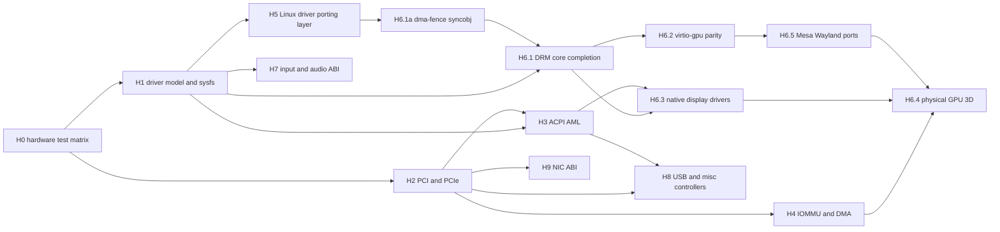

# AzamiOS Linux-Like Hardware Support and GPU Subsystem Plan (for Codex)

> **Date:** 2026-10-11. **Task IDs:** **H0–H9**. Companion to [`IMPROVEMENT_PLAN.md`](IMPROVEMENT_PLAN.md) (W6.0–W6.3 block/net throughput, W8–W10 desktop), [`BINARY_COMPATIBILITY_PLAN.md`](BINARY_COMPATIBILITY_PLAN.md) (B3.6 ioctl database, B8 `/dev`+`/sys` formats) and [`USERSPACE_IMPROVEMENT_PLAN.md`](USERSPACE_IMPROVEMENT_PLAN.md).
> **Goal:** a driver model, bus layer and GPU stack whose *userspace-visible ABI* is Linux's (sysfs, uevent, `/dev` nodes, ioctl structs, DRM/KMS, evdev, ALSA), so unmodified Linux userspace (libdrm, Mesa, Weston/Sway, libinput, udev-style tools, `lspci`, `lsusb`) runs against it, and so Linux drivers can be ported with bounded effort.
> **Standard (`AGENTS.md`):** complete implementations only. Unsupported hardware/features must be reported honestly (`-ENODEV`, `-EOPNOTSUPP`, capability bit absent), never faked. Never touch `hdd.img`; all tests use disposable images under `build/`. Distinguish **emulated** validation (QEMU/VirtualBox) from **physical** validation in every results file.
> Skills to read per workstream are listed under each heading (`.agents/skills/<name>/SKILL.md`).

---

## 0. Baseline (audited 2026-10-11)

| Area | Verified in source | Gap |
| :--- | :--- | :--- |
| Driver model `drivers/base`, `hal/` | `bus.c`, `core.c`, `platform.c`, `pci_bus.c`, `uevent.c`; HAL `device/driver/irp/irq/pci/virtio_pci/virtqueue`; `fs/sysfs.c` exposes `/sys/bus`, `/sys/class`, `/sys/devices` | Need to verify: deferred probe, `driver_override`, `modalias`, `bind/unbind`, `remove` on hot-unplug, device links/power-domain ordering, sysfs attribute fidelity for `lspci`/udev |
| PCI `hal/pci.c` | enumeration and BARs; MSI/MSI-X referenced only by `hal/virtio_pci.h` and `drivers/usb/host/xhci.c`; no generic MSI-X API | No PCIe ECAM/`MCFG` extended config space, no capability walker API, no AER/ASPM/runtime PM, no hotplug, no SR-IOV, no `/sys/bus/pci/devices/*/{config,resource,vendor,device,class,irq,enable,rescan}` fidelity proof |
| ACPI `drivers/acpi` | FADT/MADT/HPET/PM-timer/battery/thermal/power/IOAPIC; **power-off found by a byte scanner for `_S5_` in the DSDT (`acpi.c:51`)** | **No AML interpreter**: no `_STA/_CRS/_PRS/_PRT/_PS0/_PS3/_OSC/_DSM/_INI`, no namespace, no EC, no GPE handling, no `_Lxx/_Exx` events, no sleep states beyond S5, no PCI interrupt routing from `_PRT` |
| IOMMU / DMA | `kernel/mm/dma.[ch]` (masks, mappings, bounce) | No DMAR/IVRS parsing, no VT-d/AMD-Vi, no per-device domains, no `iommu_group`, no VFIO |
| Block / net | AHCI, NVMe, virtio-blk/scsi, SDHCI, FDC; e1000, e100, rtl8139/8169, tg3, pcnet, vmxnet3, virtio-net, ne2k | Throughput/recovery owned by `IMPROVEMENT_PLAN.md` W6.0–W6.3 (not duplicated here); wireless, Bluetooth and NIC offload API (`ethtool`) absent |
| USB | UHCI, EHCI, xHCI hosts; `usbhid`, `usbstorage`; core `usb.c` | No hub class driver file, no UAS, CDC-ACM/ECM/NCM, audio class, video (UVC), printer, composite handling, USB hotplug uevents/`/sys/bus/usb` fidelity, `usbfs` (`/dev/bus/usb/*` needed by libusb) |
| Input | `input.c` (903), `evdev.c`, `virtio_input.c`, `usbhid.c`; `userland/libc/include/linux/input.h` | Verify `EVIOCG*` coverage for `libinput`/`evtest`; no I²C-HID, PS/2 detail, touchpad (multi-touch slots `ABS_MT_*`), `uinput`, force-feedback, `/dev/input/by-*`, `ID_INPUT_*` properties |
| Audio | `ac97`, `hda`, `es1370`, `sb16`, `mpu401`, `pcspeaker`, `sound.c` | ALSA char-device ABI (`/dev/snd/*`, `SNDRV_PCM_IOCTL_*`, mmap rings) — planned in `IMPROVEMENT_PLAN.md` W9.0, tracked here as H7 |
| **GPU / DRM** (`drivers/gpu/drm` ≈ 5.0 kLoC + `drivers/video` ≈ 1.8 kLoC) | `drm_drv.c` registers `/dev/dri/card<N>` and `renderD<128+N>` and `/sys/class/drm/cardN`; `drm_ioctl.c` implements VERSION/GET_CAP/SET_CLIENT_CAP/MASTER/GET_UNIQUE/MAGIC, GEM close/flink/open, PRIME **handle→fd and fd→handle**, WAIT_VBLANK, dumb create/map/destroy, MODE_{GETRESOURCES, GETCRTC, SETCRTC, GETCONNECTOR, GETENCODER, GETPLANE(RESOURCES), SETPLANE, ADDFB(2), GETFB, RMFB, DIRTYFB, PAGE_FLIP, CURSOR(2), GETPROPERTY, GETPROPBLOB, OBJ_(GET/SET)PROPERTY, ATOMIC, CREATE/DESTROYPROPBLOB}; `drm_atomic.c` (atomic check/commit with test-only), `drm_vblank.c` (vblank thread, flip events), `drm_gem.c` (handles, blit helpers). Backends: **bochs**, **simpledrm**, **vmwgfx** (SVGA2), **virtio-gpu** (`virtgpu_drm.c`: GETPARAM, CONTEXT_INIT, MAP, RESOURCE_CREATE/INFO, EXECBUFFER → `SUBMIT_3D`, Virgl capsets, EDID). `gpu_isa.h` (747 lines) documents Intel/Radeon/SVGA/virgl command ISAs but is **reference-only**. Userspace: `azwm` compositor, `libgame` hw3d, `3d_test`, `demo3d` | **No synchronisation objects**: no `dma-fence`, `sync_file`, `DRM_IOCTL_SYNCOBJ_*`, no explicit-sync flip (`IN_FENCE_FD`/`OUT_FENCE_PTR`); **linear-only framebuffers** (`ADDFB2` rejects every non-linear modifier, `drm_ioctl.c:511`) and no `IN_FORMATS`/`GETFB2`; no `DRM_CAP_ADDFB2_MODIFIERS`/`SYNCOBJ`; no `DRM_IOCTL_MODE_{GETPLANE zpos,rotation,blend}` property fidelity proof; no `drm_lease`; no `DRM_IOCTL_MODE_LIST_LEASES`; no EDID-driven mode list/hotplug uevent (`HOTPLUG=1`); **no real GPU driver** (Intel, AMD, NVIDIA): only emulated devices; no Mesa/libdrm/GBM ports; no virtio-gpu blob/host-visible/cross-domain; no GPU reset/recovery, scheduler, or memory manager (TTM-like) |
| Compatibility shim | `include/azami/linux_compat.h` (463), `kernel/linux_compat_{irq,devres,fw}.c`, `kernel/net/linux_compat_net.c`, `include/azami/linux_netdev.h` | Small (≈ 1.6 kLoC): IRQ, devres, firmware, netdev only. No PCI/DMA-mapping/workqueue/timer/idr/kref/ww_mutex/`dma_fence`/`drm_*` helpers/regmap/clk/regulator/gpio/pinctrl — blocks porting real Linux drivers |
| Validation | Boot matrix, ABI probe; `tests/semantics` | No `tests/hardware`/`tests/gpu` suites, no `igt`-style KMS tests, no QEMU device matrix, no physical-hardware log archive |

> [!IMPORTANT]
> Every task needs an oracle: run the same userspace (libdrm tests, `kmscube`, `modetest`, `evtest`, `lspci -vv`, `udevadm`-style readers, IGT) against a real Linux guest on the same QEMU device, and diff. Self-written probes agreeing with the kernel prove nothing.

---

## H0. Hardware Test Infrastructure and Device Matrix (do first)

**Skills:** `qemu-for-kernel-development`, `qemu-kvm`, `kernel-testing`, `strace-ltrace`

1. **`tests/hardware/` runner** (extends W6.0): disposable disks, QEMU device matrix generated from `tests/hardware/matrix.yaml`:
   - GPU: `-vga std` (BGA), `-device virtio-gpu-pci`, `virtio-gpu-gl-pci` (host GL, when available), `virtio-gpu-pci,blob=true,hostmem=…`, `-vga vmware`, `-vga qxl` (out-of-scope marker), `ramfb`+GOP via OVMF, `-vga none` (headless).
   - Storage/net/USB: `ich9-ahci`, `nvme`, `virtio-blk/scsi`, `usb-xhci/ehci/uhci` with `usb-kbd/mouse/tablet/storage/hub/audio/net`, `e1000/e1000e/rtl8139/virtio-net`, `intel-hda`, `ac97`.
   - CPU/chipset: `-machine q35` and `pc`, `-smp 1/4/16`, `-cpu host|qemu64|max`, ACPI on/off, `-device intel-iommu`/`amd-iommu`, `pcie-root-port` hotplug via QMP `device_add`/`device_del`.
2. **Hotplug and fault injection harness:** QMP-driven `device_add/del`, `system_reset`, `nvme` and `virtio` error injection (`-device …,x-…`), allocation-failure injection (kernel `fault_inject` knob added in this task), IRQ storm injection.
3. **Real-hardware lane:** `scripts/hw-report.sh` collects `lspci -nnvv`-equivalent (`/sys/bus/pci`), ACPI tables (`/sys/firmware/acpi/tables/*` once present), `dmesg`, and a *driver coverage report* (`vendor:device` → bound/unbound driver) from a physical machine booted via the Limine ISO. Reports are archived in `tests/hardware/reports/<machine>.md`; failures there are tracked as issues but are never reported as "passed in emulation".
4. **Coverage dashboard:** `docs/HARDWARE_STATUS.md` generated from the matrix (device × {probe, DMA, IRQ, hotplug, suspend/resume, reset recovery, emulated, physical}); never hand-edited.
5. **Gate 5:** `./tests/hardware/run.sh --quick` (≤ 10 min, TCG-capable subset) must report 0 failures; extend `CODEX_EXECUTION_PLAN.md §2`.

---

## H1. Driver Model and sysfs/uevent Fidelity

**Skills:** `platform-device-model`, `device-drivers`, `linux-kernel-architecture`, `writing-char-drivers`

| # | Task | Details | Verify |
| :- | :--- | :--- | :--- |
| H1.1 | Core semantics | `probe` returning `-EPROBE_DEFER` + deferred-probe queue retried on every new driver/device; `driver_override`; explicit `bind`/`unbind`/`new_id` via sysfs; `remove`+`shutdown` ordering (reverse of probe); device parent/child teardown; `device_link` for supplier→consumer ordering; reference-counted `struct device` lifetime with a leak checker | Unit tests with synthetic bus; unbind/bind stress 10 000× leaves no leaked memory (PMM counters) |
| H1.2 | sysfs ABI | Real attribute files, permissions, `0644`/`0444`, `show/store` buffer limits (PAGE_SIZE), `uevent`, `modalias`, `subsystem`/`driver` symlinks, `power/{control,runtime_status}`, `/sys/devices/pci0000:00/0000:00:1f.2/...` hierarchy, `/sys/dev/{char,block}/MAJ:MIN`, `/sys/class/{drm,input,sound,net,block,tty,hwmon,power_supply,thermal,backlight,leds,rtc}` | Golden tree dump from a QEMU Linux guest diffed structurally (names, types, perm, symlink targets) |
| H1.3 | uevent / netlink | `NETLINK_KOBJECT_UEVENT` socket (kernel-group 1) emitting Linux-format messages (`ACTION=add\0DEVPATH=…\0SUBSYSTEM=…\0MAJOR/MINOR/DEVNAME/DEVTYPE/SEQNUM/MODALIAS`), plus `/sys/kernel/uevent_seqnum`, `uevent_helper`; `coldplug` by writing `add` to `uevent` | A static `udevd`-like reader (port `eudev` or `mdev`, BusyBox) creates `/dev` nodes from events; `udevadm monitor`-style output matches host for a hotplugged device |
| H1.4 | devtmpfs | Kernel-created nodes with correct mode/ownership/major:minor (`Documentation/admin-guide/devices.txt`); `/dev/char/*`, `/dev/block/*`, `/dev/disk/by-{id,label,uuid,path}` by udev rules/mdev | `ls -l /dev` golden compare for devices present in the matrix |
| H1.5 | Power management framework | `dev_pm_ops` (`suspend/resume/freeze/thaw/poweroff/restore`, `runtime_suspend/resume/idle`), `pm_runtime_*` refcounting, wakeup sources, `/sys/power/{state,mem_sleep}`; system-sleep orchestration from `drivers/acpi/power.c` after H3 | Per-driver suspend/resume cycle test under QEMU `system_wakeup`; runtime-PM counters verified |
| H1.6 | Driver-binding tables | Generate `/lib/modules/<ver>/modules.alias`-equivalent from driver ID tables (`pci:v…d…sv…sd…bc…i…`, `usb:v…p…`, `acpi:…`, `of:…`); `MODULE_DEVICE_TABLE` macro in the compat layer; `kmod`-style autoloading hook via uevent for loadable modules (see `docs/MODULES.md`) | Plug a matching device → module auto-loaded |

---

## H2. PCI / PCIe Layer

**Skills:** `device-drivers`, `hypervisor-internals`, `kernel-concurrency`, `datasheet-and-refmanual-reading`

| # | Task | Details | Verify |
| :- | :--- | :--- | :--- |
| H2.1 | ECAM config access | Parse ACPI `MCFG`; memory-mapped extended config (4 KiB/function); fall back to `CF8/CFC` only for the first 256 bytes; multiple segments/domains; correct handling of ECAM above 4 GiB | `lspci -xxxx` equivalent via `/sys/bus/pci/devices/*/config` matches host for the same QEMU device |
| H2.2 | Capability API | `pci_find_capability`, `pci_find_ext_capability`, safe iteration (loop limits for malformed lists), PCIe cap fields, `pci_enable_device_mem/io`, `pci_set_master`, BAR sizing/64-bit/prefetchable, `pci_request_regions`, `pci_iomap`, ROM BAR | Fuzz the config space (QEMU `pci-testdev`/malformed list) — no infinite loops/crashes |
| H2.3 | MSI / MSI-X | Generic `pci_alloc_irq_vectors(PCI_IRQ_MSI\|MSIX\|LEGACY, min, max)`, `pci_irq_vector`, per-vector affinity (`irq_set_affinity` across x2APIC IDs), vector allocation tracked per-CPU (256-vector limit), mask/unmask via table + PBA, interrupt remapping prepared for H4; convert `nvme`, `ahci`, `virtio-net/blk/gpu`, `e1000e`-class drivers off INTx where beneficial | `/proc/interrupts` shows per-vector per-CPU counts; storm test; legacy fallback tested via `pci=nomsi` boot parameter (documented in `KERNEL-PARAMETERS.md`) |
| H2.4 | Interrupt routing | Use ACPI `_PRT` (after H3) for INTx→GSI; `IOAPIC` redirection with polarity/trigger from MADT overrides; shared-IRQ handlers with `IRQF_SHARED`; IRQ thread/bottom-half (`threaded_irq`, `tasklet`/workqueue equivalent) | IRQ-sharing test with two emulated devices on one line |
| H2.5 | Hotplug | PCIe native hotplug (slot capability + `pciehp` state machine) and ACPI hotplug (`_EJ0`, Notify 3/1 after H3); bus rescan (`/sys/bus/pci/rescan`, `remove`); resource reassignment for new bridges (window sizing, `pci=realloc`); orderly driver `remove` | QMP `device_add/del` loops (10 000×) with a traffic generator; no leaks, no crashes |
| H2.6 | PCIe error handling | AER (correctable/uncorrectable/fatal), `pci_error_handlers` (`error_detected/slot_reset/resume`), link retrain, `pci_reset_function` (FLR via `PCI_EXP_DEVCTL_BCR_FLR`, PM reset, secondary bus reset), `pcie_aspm=` parameter, ASPM policy (`default/performance/powersave`) with safe whitelist | QEMU AER injection (`x-pcie-…`/`aer_inject` equivalent); FLR test on NVMe/virtio |
| H2.7 | Resource management | `iomem`/`ioport` resource tree with `/proc/iomem`/`/proc/ioports`, conflict detection, `ioremap` cache attributes (UC/WC/WB via PAT), `devm_ioremap_resource` | `/proc/iomem` golden-format compare |
| H2.8 | SR-IOV and VFIO (stretch) | `sriov_numvfs`, VF enumeration; VFIO group/container ABI (requires H4) so `qemu` can pass devices through | Not started until H4 done; tracked, not faked |

---

## H3. ACPI with a Real AML Interpreter

**Skills:** `linux-kernel-architecture`, `device-drivers`, `kernel-debugging`, `datasheet-and-refmanual-reading`

The current `_S5_` byte-scan is a stopgap; modern x86 hardware cannot be driven correctly without AML.

| # | Task | Details | Verify |
| :- | :--- | :--- | :--- |
| H3.1 | Interpreter integration | Integrate **uACPI** (MIT licensed, designed for hobby kernels) *or* ACPICA (dual BSD/GPL); decision recorded in `docs/H3_ACPI_DECISION.md` with licence review against `LICENSES/`. Provide the OSL: physical map, port/MMIO/PCI config access, locks/events/semaphores, `AcpiOsStall/Sleep`, timers, IRQ install, `AcpiOsExecute` worker, table overrides, `acpi_dbg` output. Replace `parse_s5` with `\_S5` evaluation | Boots on QEMU `pc` and `q35` and OVMF; `acpidump`-style listing from `/sys/firmware/acpi/tables`; `\_S5` found through the interpreter; interpreter run under ASan on the host against 20+ real DSDTs (from public collections) with no crash |
| H3.2 | Namespace devices | Enumerate namespace devices (`_HID/_CID/_ADR/_UID`), create `acpi:` bus devices and `/sys/bus/acpi/devices/*`; `_STA` filtering; `_CRS` resource decoding (IO, IRQ, Memory32/64, address-space descriptors, GPIO/I²C serial bus connections); `_PRS/_SRS` | PS/2, RTC, COM ports, HPET, PNP0C0x devices discovered through the namespace |
| H3.3 | PCI integration | Root bridge `PNP0A08` `_CRS` windows for resource assignment; `_PRT` interrupt routing (H2.4); `_OSC` negotiation (PCIe native hotplug/AER/PME ownership); `_DSM` PCI quirks; ACPI companion devices (`ACPI_COMPANION`) | Interrupt routing matches the host kernel on q35; `/sys/devices/pci0000:00` has ACPI companions |
| H3.4 | Events and power | SCI handler, GPE enable/dispatch (`_Lxx/_Exx/_Qxx`, `_REG`, `_EC`), Embedded Controller driver (`PNP0C09`, ports 62/66), `_Sx` sleep via `\_PTS/\_GTS/\_WAK`, `_PSx` and `_PRx` device power methods wired to runtime PM (H1.5), power button/lid/sleep button as `input` devices (`KEY_POWER`, `SW_LID`), `_PSR/_BIF/_BIX/_BST` battery and `power_supply` class, thermal zones with `_TMP/_PSV/_CRT` + cooling devices | Power button QMP `system_powerdown` → `KEY_POWER` event → graceful poweroff; battery/thermal values appear under `/sys/class/power_supply` and `/sys/class/thermal` |
| H3.5 | Tables and NUMA | `SRAT/SLIT/HMAT` (links to W6.4 NUMA), `DMAR/IVRS/IORT` (H4), `BGRT`, `FPDT`, `HPET`, `MCFG`, `NFIT` (read-only), `SSDT` load via `Load/LoadTable`, ACPI table upgrade via initrd (documented) | `/sys/firmware/acpi/tables/*` byte-identical to the loaded tables |
| H3.6 | Fallback policy | `acpi=off`, `acpi=noirq`, `acpi=force` parameters; when AML evaluation fails the kernel logs, degrades (legacy PIC/IOAPIC defaults) and continues; unsupported methods return `AE_NOT_IMPLEMENTED` and are never faked | Boot-matrix cases with the parameter set |

---

## H4. IOMMU and DMA

**Skills:** `hypervisor-internals`, `kernel-security`, `virtual-memory-paging-and-tlb`, `kernel-memory-management`

1. **DMA API completion** (`kernel/mm/dma.c`): `dma_set_mask_and_coherent`, `dma_map_page/unmap`, `dma_map_sg`, `dma_alloc_coherent/free`, `dma_sync_*_for_cpu/device`, CMA-like contiguous region (`cma=` parameter), SWIOTLB bounce buffering for devices with < 64-bit masks, DMA pools. Add `dma-debug` mode: track mappings, catch unmap-without-map, double-unmap, device access after free (quarantine) — enabled by `dma_debug=1`.
2. **Intel VT-d** (`DMAR` table): root/context tables, second-level page tables (4/5-level), queued invalidation, fault reporting (`/sys/class/iommu/dmar*`), interrupt remapping with IRTE (also unlocks x2APIC > 255 CPUs), `intel_iommu=on/off/sm_on`, identity vs DMA domains (`iommu.passthrough`, `iommu.strict`).
3. **AMD-Vi** (`IVRS`): device table, command/event buffers, IRTE; same domain API. (Second priority; QEMU `amd-iommu` available for testing.)
4. **IOMMU core API:** `iommu_domain`, `iommu_group` (from ACS/topology), `/sys/kernel/iommu_groups/*`, `iommu_map/unmap/iova_to_phys`, per-device default domain; ARM SMMU deliberately out of scope (x86_64 only today).
5. **VFIO** (`/dev/vfio/vfio`, groups, `VFIO_IOMMU_MAP_DMA`, `VFIO_DEVICE_GET_REGION_INFO`) so a ported `qemu` can pass a device through; deferred until H4.2 passes.
6. **Verify:** QEMU `-device intel-iommu,intremap=on` boot; DMA fault injection (device writes outside its mapping must fault and be reported, never corrupt memory); throughput regression ≤ 5 % vs identity mapping on `virtio-net` and `nvme`; the `tests/bench` suite records IOMMU on/off.

---

## H5. Linux Driver Porting Layer (`linux_compat`)

**Skills:** `device-drivers`, `linux-kernel-modules`, `kernel-concurrency`, `kernel-memory-management`, `kernel-security`

Real hardware coverage comes from reusing Linux drivers, not rewriting each one. The licence (kernel is GPL-2.0; confirm `COPYING`/`LICENSES` for the AzamiOS tree) must allow it; record per imported file its Linux version, SPDX id and local modifications in `drivers/IMPORTED.md`.

| # | Task | Details | Verify |
| :- | :--- | :--- | :--- |
| H5.1 | Audit and scope | Inventory what existing ports consume (`linux_compat.h`, `linux_netdev.h`, devres, irq, fw). Write `docs/H5_COMPAT_SCOPE.md`: the exact Linux API subset (by header) needed for the target driver list (H6, H8), derived by compiling candidates with `-Werror=implicit-function-declaration` and counting unresolved symbols | Symbol-gap report committed; each gap becomes a task |
| H5.2 | Core primitives | `kref`, `list_head/hlist/rbtree/xarray/idr/ida`, `container_of`, `mutex/rwsem/spinlock/seqlock/completion/wait_queue/rcu (simple)`, `workqueue/delayed_work`, `timer_list/hrtimer`, `kthread`, `atomic_*/bitops`, `ktime`, `jiffies`, `min/max/clamp/ARRAY_SIZE`, `ERR_PTR`, `kmalloc/kzalloc/kvmalloc/kmem_cache`, `copy_to/from_user`, `sg_table/scatterlist`, `firmware_request`, `debugfs` (read-only), `tracepoint` stubs that compile to nothing but are **documented as non-functional** | A mini-driver corpus (`tests/compat_drivers/`) compiled and loaded with KUnit-like tests |
| H5.3 | Bus wrappers | `pci_driver`, `platform_driver`, `usb_driver`, `i2c_driver`, `spi` (when needed), `input_dev`, `net_device`, `snd_card`, `drm_device` mapped onto native AzamiOS subsystems (not copied: the native bus code stays the single source of truth) | Existing native drivers can optionally be rebuilt through the shim for comparison |
| H5.4 | `dma_fence`/`dma_resv`/`dma-buf` | Implement as a native subsystem (needed by H6.1 too): `dma_fence` (signal/wait/callbacks/timeline), `dma_resv`, exported `dma_buf` file with `map/unmap/mmap/vmap`, `sync_file` fd (`SYNC_IOC_MERGE/FILE_INFO`), `/dev/dma_heap/system`; integrates with PRIME (already fd-based) | Fence ordering stress; `sync_file` merge test against host results |
| H5.5 | Loadable-module ABI | Module `vermagic`, symbol export (`EXPORT_SYMBOL`/`_GPL`), taint rules documented; modules built out-of-tree with a `Kbuild`-compatible Makefile fragment shipped in `docs/MODULES.md` | `insmod`/`rmmod` cycles with refcount checks |
| H5.6 | Rules | Never silently no-op a Linux API that has side effects: unimplemented calls fail the build (`__compiletime_error`) rather than link to an empty stub. Keep a generated list of intentionally no-op instrumentation macros | CI greps that every shim function has a test or `STUB-DOCUMENTED` tag |

---

## H6. GPU Subsystem

**Skills:** `device-drivers`, `kernel-memory-management`, `gpu-memory-model`, `virtual-memory-paging-and-tlb`, `qemu-for-kernel-development`, `kernel-debugging`

Principle: **match the Linux DRM uAPI first, then add hardware.** Userspace (Mesa, wlroots, Weston, X11 `modesetting`, SDL2/KMSDRM) already speaks that ABI.

### H6.1 DRM core completion (kernel ABI exactness)

| # | Task | Details | Verify |
| :- | :--- | :--- | :--- |
| H6.1a | Synchronisation | `DRM_IOCTL_SYNCOBJ_{CREATE,DESTROY,HANDLE_TO_FD,FD_TO_HANDLE,WAIT,RESET,SIGNAL,TIMELINE_WAIT,TRANSFER,QUERY,TIMELINE_SIGNAL,EVENTFD}` on top of H5.4 `dma_fence`; `DRM_CAP_SYNCOBJ`, `DRM_CAP_SYNCOBJ_TIMELINE`; atomic `IN_FENCE_FD` plane property and `OUT_FENCE_PTR` CRTC property with `sync_file` completion at flip; implicit sync via `dma_resv` for PRIME buffers (`DMA_BUF_IOCTL_EXPORT_SYNC_FILE/IMPORT_SYNC_FILE`) | IGT `syncobj_*`, `kms_atomic` with fences; `wlroots`/Weston explicit-sync path runs |
| H6.1b | Formats and modifiers | `DRM_IOCTL_MODE_GETFB2`, `IN_FORMATS` blob per plane (format + modifier matrix), `DRM_FORMAT_*` full 8/10/16-bit RGB/YUV list the hardware actually supports, `DRM_CAP_ADDFB2_MODIFIERS`, `DRM_FORMAT_MOD_LINEAR`, vendor modifiers (Intel X/Y/Yf tiling, AMD DCC) only when a real driver implements them; keep rejecting unknown modifiers with `-EINVAL` (current behaviour at `drm_ioctl.c:511`, now data-driven by `IN_FORMATS`) | `modetest -p` listing equals host layout shape; ADDFB2 with each advertised pair succeeds, each unadvertised fails |
| H6.1c | KMS property fidelity | Standard plane/CRTC/connector properties and ranges: `type`, `FB_ID`, `CRTC_ID`, `SRC_*/CRTC_*`, `rotation`, `zpos`, `alpha`, `pixel blend mode`, `COLOR_ENCODING/RANGE`, `scaling filter`, CRTC `ACTIVE`, `MODE_ID`, `VRR_ENABLED`, `GAMMA_LUT/DEGAMMA_LUT/CTM` + `GAMMA_LUT_SIZE`, connector `DPMS`, `EDID`, `link-status`, `non-desktop`, `HDR_OUTPUT_METADATA`, `Colorspace`, `max bpc`, `panel orientation`; legacy gamma ioctls (`GETGAMMA/SETGAMMA`) | IGT `kms_properties`, `kms_plane`, `kms_color` on virtio-gpu/bochs where supported; unsupported properties absent, not faked |
| H6.1d | EDID and hotplug | Parse EDID (base + CEA extension + DisplayID) into `drm_display_mode` lists (preferred, detailed timings, standard timings), physical size, make/model strings; **connector hotplug uevent** (`HOTPLUG=1 CONNECTOR=<id>`); `status` sysfs attr; `force=`/`video=` kernel parameters (`video=Virtual-1:1920x1080@60`) | Change the QEMU display resolution/QMP `display-reload` → uevent → compositor re-modes |
| H6.1e | Client/master semantics | `DRM_IOCTL_SET_MASTER/DROP_MASTER` with VT/seat arbitration (`drm_master` handoff on VT switch), `DRM_IOCTL_AUTH_MAGIC`, render-node permission model (`0666`, no KMS), `DRM_CLIENT_CAP_{ATOMIC,UNIVERSAL_PLANES,WRITEBACK_CONNECTORS,CURSOR_PLANE_HOTSPOT}`, DRM **leases** (`DRM_IOCTL_MODE_CREATE_LEASE/LIST_LESSEES/GET_LEASE/REVOKE_LEASE`), `DRM_IOCTL_GET_STATS`/`DRM_IOCTL_MODE_GETPLANE` error codes, `DRM_IOCTL_CRTC_GET_SEQUENCE/QUEUE_SEQUENCE` | Weston/Sway start, VT-switch away and back, resume without leaks |
| H6.1f | Memory management | A real GPU memory manager: GEM object backing (shmem-style pageable, contiguous, VRAM), `drm_mm` range allocator, eviction/LRU for VRAM, `mmap` offsets with fake-offset manager and `VM_PFNMAP`, `drm_gem_object_funcs`, per-file handle tables with IDR, `GEM_FLINK` kept for legacy only, `DRM_IOCTL_GEM_CHANGE_HANDLE`, `fdinfo` DRM usage keys (`drm-driver`, `drm-pdev`, `drm-client-id`, `drm-memory-*`) for `nvtop`/`gputop` | Memory-pressure test (1000 buffers, VRAM exhaust → evict); `/proc/<pid>/fdinfo/<drm fd>` golden compare |
| H6.1g | Reset and robustness | Job timeout detection, per-engine reset, context banning, `DRM_IOCTL_*_GET_RESET_STATS` per driver, uevent `RESET=1`; DRM scheduler (`drm_sched`: entities, run queues, priorities, fences) as shared infrastructure for H6.3/H6.4 | Inject hang (virtgpu fence never signals) → timeout → recovery without kernel panic |
| H6.1h | Debuggability | `/sys/kernel/debug/dri/N/{state,framebuffer,gem_names,clients,vblank}` readable via a minimal debugfs, `drm.debug` bitmask kernel parameter, `/sys/class/drm/card*-<connector>/{status,enabled,modes,edid,dpms}` | `drm_info`-style tool output matches expected |

### H6.2 virtio-gpu to feature parity (primary virtual target)

The device already supports 2D, Virgl 3D contexts/`SUBMIT_3D`, EDID and cursor. Missing virtio-gpu 1.2+ features, in order:

| # | Feature | Notes | Verify |
| :- | :--- | :--- | :--- |
| H6.2a | `VIRTIO_GPU_F_RESOURCE_UUID`, `F_RESOURCE_BLOB`, `F_CONTEXT_INIT` | Blob resources (`RESOURCE_CREATE_BLOB`, `SET_SCANOUT_BLOB`, `RESOURCE_MAP_BLOB/UNMAP_BLOB`), host-visible memory region (shared memory region BAR), guest `mmap` of host memory with caching attributes, `DRM_IOCTL_VIRTGPU_RESOURCE_CREATE_BLOB`, `CONTEXT_INIT` capset selection | `qemu -device virtio-gpu-pci,blob=true,hostmem=256M` + Mesa virgl/venus; zero-copy scanout |
| H6.2b | Fencing | `VIRTIO_GPU_FLAG_FENCE` + `VIRTIO_GPU_FLAG_INFO_RING_IDX` (per-ring fences, `fence_ctx_idx`), integrate with `dma_fence`/syncobj (H6.1a); remove any busy-wait in `virtio_gpu_cmd.c` | Fence completion ordering test across 4 contexts |
| H6.2c | Capsets | virgl (id 1), virgl2 (id 2), **venus** (Vulkan, id 4), **drm native context** (id 6, amdgpu/i915 native contexts via host) — advertise only what `GET_CAPSET_INFO` reports | `vulkaninfo` works through venus when host provides it; otherwise honest absence |
| H6.2d | `VIRTIO_GPU_F_EDID` multi-scanout, hotplug config-change interrupt, `VIRTIO_GPU_EVENT_DISPLAY`, resize | Compositor follows window resize in QEMU GTK/SDL | |
| H6.2e | Robustness | Descriptor exhaustion, device-reported errors (`VIRTIO_GPU_RESP_ERR_*`), reset (`VIRTIO_CONFIG_S_NEEDS_RESET`), scanout teardown on `rmmod`; zero-length/over-large `EXECBUFFER` validation (bounded size ≤ device `max_*`) | Fuzz execbuffer sizes/ring idx; no OOB/leak |

### H6.3 Display-only native drivers (modeset without 3D)

Gives real hardware a Linux-compatible KMS device with GOP/VBE as fallback.

| # | Task | Details | Verify |
| :- | :--- | :--- | :--- |
| H6.3a | `simpledrm` hardening | UEFI GOP/`ramfb`/Limine framebuffer → atomic KMS device with correct format list (`XRGB8888`, `RGB565`, `XRGB2101010`), `drm_panic`-style last-message screen, handoff when a native driver later takes over (`remove_conflicting_framebuffers` equivalent) | Boot without any native driver gives a working `/dev/dri/card0` for Weston `pixman` renderer |
| H6.3b | Native Intel display (Gen9–Gen12 `display` only) | Port structure, not blobs: PCI probe, GMBUS/DDC EDID read, DPLL/PLL programming, pipe/transcoder/plane programming, eDP/DP/HDMI link training, panel power sequencing, backlight (PWM/DPCD/ACPI `_BCM` after H3), hardware cursor, GTT mapping for scanout from system memory. Either implement natively using `gpu_isa.h` register references **or** port from Linux `i915/display` via H5 (decision doc `docs/H6_INTEL_DECISION.md`, include licence + size estimate) | Real Intel machines (physical lane) → native resolution, hotplug, DPMS; not claimed done from emulation |
| H6.3c | AMD display (DCN/DCE) | Considered **only** via the H5 porting layer (Linux `amdgpu/display` is ~hundreds of kLoC and requires `psp`/SMU firmware). Explicit decision record; until then rely on `simpledrm` + native modeset of GOP | Decision doc committed; no placeholder driver |
| H6.3d | Legacy `fbdev` | Keep `drivers/video/fbdev.c` as a *client* of DRM (fbdev emulation over `simpledrm`/native KMS) providing `/dev/fb0` with `FBIOGET_{V,F}SCREENINFO`, `FBIOPUT_VSCREENINFO`, `FBIOPAN_DISPLAY`, mmap; console (`fbcon`-like) draws through it | Linux `fbset`, `fbi`, `mplayer -vo fbdev` ports; text console unaffected |

### H6.4 3D acceleration on physical GPUs (long-term, decision-gated)

Do **not** start before H5, H6.1a–f and H4 are complete. A real GPU driver needs: firmware loading (`firmware_request`, initramfs `/lib/firmware`), GPU virtual memory (PPGTT/GPUVM, `drm_gpuvm`), command-stream submission with `drm_sched`, interrupt/fence plumbing, power management (RC6/clock gating), reset recovery, and a userspace Mesa driver speaking the vendor ioctls.

1. **Selection gate (`docs/H6_PHYSICAL_GPU_DECISION.md`):** compare (a) port Linux `i915` (Gen9+, Mesa `iris`) ≈ 400 kLoC with the compat layer, (b) port `xe`, (c) port `amdgpu` (needs ~ 1 MLoC incl. display, firmware blobs under redistribution licences), (d) **nouveau/NVK** (GSP firmware required on Turing+), (e) smaller targets first: Broadcom V3D/VC4-style open GPUs only apply to non-x86 boards and are out of scope, (f) software rendering only. The default recommendation is **(f) then (a)**: Mesa `llvmpipe`/`softpipe` via KMS dumb buffers now (H6.5), and a port of `i915` through H5 for Gen9–Gen12 integrated graphics later.
2. **Acceptance for any physical-GPU driver:** `modetest`, `kmscube` (GLES via Mesa), `glxgears`/`es2gears_wayland`, Vulkan `vkcube`, IGT subset, 1-hour stress with GPU reset injection, suspend/resume, and PRIME offload between two devices. Results go into `docs/HARDWARE_STATUS.md` marked *physical*.
3. **Never** advertise capabilities (`DRM_CAP_*`, Vulkan, OpenGL versions) the driver cannot deliver.

### H6.5 Userspace graphics stack (Linux ports)

**Skills:** `cross-gcc`, `meson`, `ninja`, `cuda`/`hip-rocm`/`triton-lang` (only for compute-stack background), `dynamic-linking`

Ports recipes follow `USERSPACE_STATIC_RECOMP_LINUX_PLAN.md` U4 (`tools/linux/ports/<pkg>.mk`, checksums, smoke rows). Mesa and Wayland stacks are dynamic by nature, so this depends on **U1** (full ldso: GNU hash, symbol versioning, TLS GD/TLSDESC, RELRO, `dl_iterate_phdr`), **B1/B2** and the dynamic-musl matrix.

| Stage | Packages | Smoke test |
| :- | :--- | :--- |
| S0 | `libdrm` (+ `modetest`, `drmdevice`), `pixman`, `libpng`, `freetype`, `fontconfig`, `libxkbcommon`, `xkeyboard-config`, `libevdev`, `mtdev` | `modetest -c -p` lists connectors/planes; `evtest` prints events |
| S1 | `wayland`, `wayland-protocols`, `libinput`, `eudev` or `mdev`, `seatd` (or `libseat` builtin) | `libinput list-devices`, `seatd-launch` grants DRM master/input |
| S2 | `mesa` (gallium: `softpipe`, `llvmpipe` (needs LLVM — see U9.0), `virgl`, `zink` later; `kmsro` for display-only scanout; EGL `gbm`/`surfaceless`; GLES2/3; Vulkan `lavapipe` optional), `libgbm` | `kmscube` renders on `virtio-gpu` via virgl; `es2gears_wayland` via llvmpipe on `simpledrm` |
| S3 | `weston` (DRM backend) or `wlroots`+`sway`, `foot`/`weston-terminal`, `grim`/`wayland-info` | Boots to a Wayland session; 60 s with an animation test: dropped frames < 1 %, no crash; screenshot hash compared with expected |
| S4 | `xorg-server` (`modesetting` driver, `glamor`), `xwayland`, `xterm` | `xeyes` under Weston via Xwayland |
| S5 | `SDL2` (KMSDRM + evdev), `cairo`, `pango`, GTK4 (later) | `testdraw2` and a Cairo clock render |

Native desktop (`userland/apps/azwm`, `libgame/game_hw3d`) keeps working and becomes a *client* of the same KMS ABI (no private ioctls); any private `/dev` usage found in `azwm/compositor.c` is migrated to the standard DRM ioctls and listed in the results file.

### H6.6 Compute and offload (stretch, depends on H6.4)

Optional: OpenCL via Mesa `rusticl`/`clover` on llvmpipe, `/dev/accel*` (`accel` subsystem) for NPUs, compute-only render nodes. Record scope only after H6.4 selection; no placeholder device nodes.

---

## H7. Input and Audio (Linux ABI)

**Skills:** `device-drivers`, `writing-char-drivers`, `gpio-baremetal` (for protocol background), `uart-serial-baremetal`

1. **evdev fidelity:** every `EVIOCG*` (`VERSION, ID, REP, KEYCODE(_V2), NAME, PHYS, UNIQ, PROP, MTSLOTS, KEY, LED, SND, SW, BIT(ev), ABS(abs), FFEFFECTS, GRAB, REVOKE, MASK, CLOCKID`) and `EVIOCS*`; `read` semantics with `SYN_DROPPED` on queue overflow, `EV_MSC/EV_SYN` ordering, per-client buffers, `poll/epoll/O_NONBLOCK`, `CLOCK_MONOTONIC` timestamps (`EVIOCSCLOCKID`), `struct input_event` 24-byte layout (x86-64). Multi-touch protocol B (`ABS_MT_SLOT/TRACKING_ID/POSITION_X…`). Verify with the real `evtest`, `libevdev` test-suite and `libinput record/replay`.
2. **Devices:** PS/2 (i8042 keyboard/mouse, touchpad protocols Synaptics/ALPS/ELAN absolute modes), USB HID (full report-descriptor parser, boot-protocol fallback, hid-multitouch, hid-generic, game-pad quirks), **I²C-HID** over ACPI (`PNP0C50`, needs H3/I²C controllers: `i2c-i801` exists, add `designware`), `virtio-input` (exists), Bluetooth HID later. `uinput` (`/dev/uinput`) so user-space remappers work.
3. **Properties for libinput:** `ID_INPUT*`/`ID_INPUT_KEYBOARD/MOUSE/TOUCHPAD` are udev-rule outputs; ship rules (`60-input-id`, `70-touchpad`) in the udev port (H1.3) and `/dev/input/by-{id,path}` symlinks.
4. **Audio (ALSA ABI)** — implement as scheduled in `IMPROVEMENT_PLAN.md` W9.0, with these additions: `/dev/snd/{controlC0,pcmC0D0p,pcmC0D0c,timer,seq}`, ioctl set `SNDRV_PCM_IOCTL_{INFO,HW_PARAMS,SW_PARAMS,PREPARE,START,DROP,DRAIN,PAUSE,DELAY,STATUS,SYNC_PTR,WRITEI_FRAMES,READI_FRAMES,HWSYNC,CHANNEL_INFO}`, `mmap` of status/control pages and the DMA buffer, `SNDRV_CTL_IOCTL_{CARD_INFO,ELEM_LIST,ELEM_READ,ELEM_WRITE}`, `/proc/asound/*`; drivers HDA (codec parsing, widgets, jack detection), AC97, virtio-snd (new, high value in VMs), USB audio class. Verify with `alsa-lib`, `aplay/arecord/amixer`, `tinyalsa`, then `PipeWire`/`wireplumber` smoke test and a loopback glitch test (xruns = 0 for 60 s at 48 kHz/256 frames).

---

## H8. USB, Storage and Misc Controllers

**Skills:** `device-drivers`, `bus-drivers-i2c-spi`, `protocol-analysis`

1. **USB core completion:** hub class (port power/reset/over-current, hub depth 5, TT for FS/LS behind HS hubs), device enumeration with retry/timeouts, configuration/interface/endpoint parsing (bounded descriptor walks — fuzz target), `usb_driver` binding via ID tables, hotplug/`remove` safety, **usbfs** (`/dev/bus/usb/BBB/DDD`, `USBDEVFS_*` ioctls, `/sys/bus/usb/devices/*` attributes) so `libusb` works, autosuspend, LPM/U1/U2 off by default.
2. **xHCI hardening:** MSI-X with per-interrupter rings, streams, scatter-gather, isoc scheduling, port-reset quirks, command-ring recovery on stall, 64-bit DMA masks via H4; UHCI/EHCI companion routing.
3. **Class drivers:** mass storage BOT **and UAS**, CDC-ACM (`/dev/ttyACM*`), CDC-ECM/NCM and RNDIS (USB networking), HID (H7), audio (H7), video UVC (V4L2 subset — separate H9 decision), printer (`usblp`), hub, FTDI/CP210x/PL2303 serial adapters.
4. **Storage extras:** SD/eMMC via SDHCI (power sequencing, tuning, HS200/HS400 where hardware exists), NVMe features beyond W6.1 (namespace management, SMART via `nvme-cli`, `/dev/ng*`), `SCSI` generic (`/dev/sg*` and `SG_IO` for `sg3_utils`/`smartctl`), `blkid`/`udev` by-uuid links, `loop`/`dm`-lite (`device-mapper` linear/crypt is separate and not planned here).
5. **Misc platform devices:** I²C (`i2c-dev`, `/dev/i2c-N`, SMBus), SPI (spidev) where controllers exist, GPIO chardev (`/dev/gpiochipN` v2 ABI), hwmon (`/sys/class/hwmon`: `coretemp` exists; add `k10temp`, `nct6775`-class via `isa` if hardware lanes need them), watchdog (`/dev/watchdog` ABI + `i6300esb`, `iTCO_wdt`, softdog), RTC (`/dev/rtc0` ioctls `RTC_RD_TIME/SET_TIME/WKALM_*`), TPM (`/dev/tpm0` CRB/TIS, optional), `ptp` clocks (`/dev/ptp*`, e1000e/virtio-net PHC), LEDs/backlight classes.
6. **Verify:** each controller/class with QEMU devices (H0 matrix) and 10 000× hotplug loops; `lsusb -t`, `usbutils`, `libusb` examples, `smartctl`, `i2cdetect`, `gpiodetect` ports produce Linux-equivalent output.

---

## H9. Networking Hardware Interface Compatibility

**Skills:** `device-drivers`, `ebpf` (background), `dpdk` (background), `af-xdp` (background)

W6.2 owns virtio-net throughput; this stream is the *Linux ABI around NICs*:
1. **`ethtool` ioctl (`SIOCETHTOOL`):** `ETHTOOL_GSET/GSETTINGS/GDRVINFO/GLINK/GSTATS/GSTRINGS/GRINGPARAM/GCOALESCE/GFEATURES/SFEATURES/GPERMADDR`, offload feature bits (`NETIF_F_*`: `SG, IP_CSUM/HW_CSUM, TSO, GSO, GRO, RXHASH, HW_VLAN_CTAG_*`), link-state `IFF_RUNNING/IFF_UP` and netlink `RTM_NEWLINK` notifications, `/sys/class/net/<if>/{address,carrier,operstate,speed,duplex,mtu,statistics/*,device,queues/*}`.
2. **`rtnetlink` and `nl80211`:** `RTM_{NEW,DEL,GET}LINK/ADDR/ROUTE/NEIGH` fidelity for `iproute2` (shared with U4 wave 2); wireless is **not** in scope: record in `docs/HARDWARE_STATUS.md` as unsupported (needs mac80211, regulatory, firmware, WPA supplicant), not stubbed.
3. **Multiqueue/RSS/XDP-ready:** per-queue statistics, `ethtool -l/-L` channels, RSS indirection table, NAPI-like polling budget; XDP and AF_XDP only when a consumer is scheduled (skills `af-xdp`, `ebpf`; depends on U6 `bpf`).
4. **PHY and link:** MDIO/PHY state machine for e1000/rtl8169/tg3 (autoneg, link-change IRQ, EEE off), wake-on-LAN configuration, MAC address from EEPROM/ACPI/firmware, `ip link set dev … address`.
5. **Verify:** `ethtool`, `ip -s link`, `tcpdump` (via `AF_PACKET` + BPF filter socket option), `iperf3`, `netperf` between two QEMU guests on a socket netdev; counters equal to peer's view (checked by independent peer, per W6.2).

---

## 10. Order and Dependencies



**Suggested first sequence (each is one reviewable commit group):**
1. **H0** matrix + `HARDWARE_STATUS.md` generator.
2. **H1.2/H1.3** sysfs fidelity + uevent socket (unblocks udev, libinput, Wayland compositors).
3. **H2.1–H2.3** ECAM + capability API + generic MSI-X.
4. **H5.4 → H6.1a** `dma_fence`/`sync_file`/syncobj, then **H6.1b/c/d** (formats, properties, EDID/hotplug) — makes the virtual GPU stack a correct DRM device.
5. **H6.2a/b** virtio-gpu blob + fence rings.
6. **H6.5 S0–S3** `libdrm` → Weston/Sway on `virtio-gpu` and `simpledrm` (requires U1 dynamic loader work).
7. **H3** ACPI AML (large, can proceed in parallel with 4–6).
8. **H7** evdev/ALSA fidelity; **H8** USB hub/usbfs.
9. **H4** IOMMU; later **H6.3b/H6.4** physical GPU work only after a written decision record.

Defer wireless, Bluetooth, NVIDIA proprietary-firmware GPUs, Thunderbolt, CXL and ARM SMMU; document each as unsupported rather than stubbing.

---

## 11. Gates (every milestone commit)

Inherit all gates from `USERSPACE_IMPROVEMENT_PLAN.md §8`, `USERSPACE_STATIC_RECOMP_LINUX_PLAN.md §9` and `BINARY_COMPATIBILITY_PLAN.md §9`. Additions:

```bash
make -j$(nproc) build/kernel.elf                    # zero new project warnings; build drivers/gpu with -Wall -Wextra
./tests/hardware/run.sh --quick                     # Gate 5 (H0): device matrix subset, 0 failures
./tests/gpu/kms_smoke.sh                            # H6: modetest/kmscube-equivalent + atomic test-only + vblank timing
./tests/gpu/igt_subset.sh                           # H6.1: curated IGT cases with an expected-fail list that carries reasons
./tests/hardware/sysfs_golden.sh                    # H1.2: structural diff vs. Linux guest dump
```

Rules: record emulated vs physical separately; skipped lanes (no KVM, no GL host, no physical machine) are reported as **skipped**; kernel logs must have no `WARN`, `BUG`, KASAN-style, lockdep-style or DMA-debug diagnostics during the run; unplug/replug loops must leave the PMM free-page count unchanged (± a documented slack).

## 12. Exit Criteria

- `docs/HARDWARE_STATUS.md` (generated) shows each supported device class with probe/DMA/IRQ/hotplug/reset results and clearly separates emulated from physical validation.
- `lspci`, `lsusb`, `lsblk`, `lshw`-class tools, `udevadm monitor`-style listeners and `libinput` work unmodified against `/sys`, `/dev`, uevent and evdev.
- ACPI is driven by a real AML interpreter; the `_S5_` byte scanner is removed; power button, battery, thermal and PCI interrupt routing come from AML.
- MSI/MSI-X, PCIe ECAM, hotplug and an IOMMU (VT-d) are in place with fault-injection tests passing.
- The DRM device passes the curated IGT subset (atomic, syncobj, fences, modifiers/`IN_FORMATS`, EDID/hotplug, leases) on virtio-gpu and `simpledrm`; Weston and Sway run unmodified through libdrm/Mesa with explicit sync, 60 s animation with < 1 % dropped frames.
- Mesa provides GL/GLES on `virtio-gpu` (virgl, and venus/Vulkan when the host offers it) and on `simpledrm`/bochs via `llvmpipe`; no capability is advertised that is not delivered.
- At least one physical display driver (Intel) has a documented decision record and, if implemented, physical-lane results; otherwise the decision record explains why GOP-based `simpledrm` remains the physical-hardware path.
- Linux drivers can be ported through the H5 layer with a documented API subset and zero silent no-op stubs.

