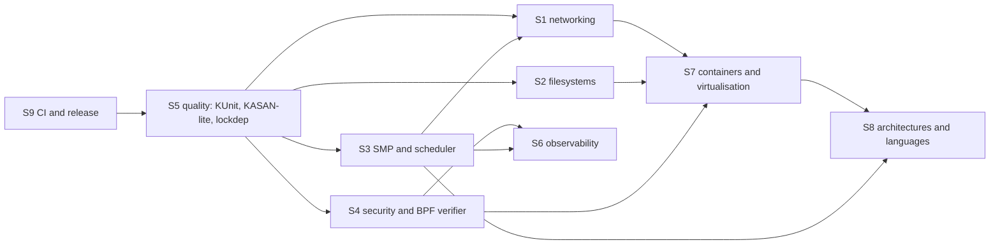

# AzamiOS Kernel Subsystem Plans: Network, Storage, SMP, Security, Quality, Observability, Containers, Architectures, Release (for Codex)

> **Date:** 2026-10-11. **Task IDs:** **S1–S9**. Companion to [`CODEX_EXECUTION_PLAN.md`](CODEX_EXECUTION_PLAN.md) (conventions, gates), [`IMPROVEMENT_PLAN.md`](IMPROVEMENT_PLAN.md) (W3.8–W7), [`USERSPACE_IMPROVEMENT_PLAN.md`](USERSPACE_IMPROVEMENT_PLAN.md) (U0–U7), [`USERSPACE_STATIC_RECOMP_LINUX_PLAN.md`](USERSPACE_STATIC_RECOMP_LINUX_PLAN.md) (U8–U10), [`BINARY_COMPATIBILITY_PLAN.md`](BINARY_COMPATIBILITY_PLAN.md) (B0–B8), [`HARDWARE_GPU_PLAN.md`](HARDWARE_GPU_PLAN.md) (H0–H9).
> **Scope of this document:** subsystems the other plans do not own. Where a stream overlaps (e.g. NVMe throughput = W6.1, GPU = H6), this plan only cross-references it.
> **Standard (`AGENTS.md`):** complete implementations only; no fake-success stubs; unsupported features return the exact Linux errno. Never touch `hdd.img`. Record emulated vs. physical validation separately.
> Each stream lists the **skills** (`.agents/skills/<name>/SKILL.md`) to read first.

---

## 0. Baseline (audited 2026-10-11)

| Area | Verified in source | Gap |
| :--- | :--- | :--- |
| **TCP/IP** `kernel/net` (arp, icmp, igmp, ipv4, udp, tcp 1274 LoC, netlink, packet, unix_socket, dhcp) | Working TCP handshake with SYN/SYN-ACK retransmit (`tcp.c:247`, `:1095`) | `tcp.c:97`: **no window scaling, SACK or timestamps negotiation**; `tcp.c:1107`: **data and FIN retransmission are explicitly out of scope** → any packet loss stalls a connection; no congestion control (Reno/CUBIC), no RTT estimator/RTO backoff proof, no delayed ACK/Nagle verification, no fast retransmit state, no TIME_WAIT/keepalive audit; **no IPv6** (zero `ip6` matches in `kernel/net`); no IP fragmentation/reassembly audit, no netfilter/nftables, no `SO_REUSEPORT`, `MSG_ZEROCOPY`, GSO/TSO/GRO, no routing policy/multiple tables, no bridge/veth/tun/tap/bonding/VLAN devices |
| **Filesystems** `fs/` | VFS (2106 LoC), ext2 (2862) with a write-back buffer cache and a flusher cadence of ~5 s, FAT32, SquashFS (zlib), tmpfs, procfs (2260), sysfs, devfs, devpts, pipe, aio, fanotify, namespace, userfaultfd | **ext2 has no journal and no extents** (`grep` found neither): a crash can corrupt the filesystem; no `fsck` tool; no ext4 read/write (extents, `64bit`, `flex_bg`, `metadata_csum`), no xfs/btrfs/f2fs, **no overlayfs, no FUSE, no NFS client, no 9p/virtiofs mount** (a `virtio_9p` driver exists under `drivers/misc` — verify filesystem layer), no page-cache unified with the buffer cache (check `mmap` of files), no `O_DIRECT`, `fallocate`/`FALLOC_FL_*` fidelity, quotas, ACL/xattr completeness (`kernel/security/acl.c` exists), no `fscrypt`/`fs-verity`/`dm-crypt`/`dm-verity` |
| **SMP / scheduler** `kernel/sched/sched.c` (4099 LoC), `arch/x86_64/cpu/smp*.c` | Per-CPU runqueues with an rb-tree on `(vruntime, tid)`, Linux `sched_prio_to_weight[]` nice table, separate SCHED_FIFO/RR queue, SCHED_IDLE, work-stealing from the busiest CPU, cpu topology (`topology.c`), cpufreq, `smp_rpc` | One global `g_sched_lock` and `g_sleep_lock` remain; no `SCHED_DEADLINE`/`SCHED_BATCH` proof; no load balancing by topology/cache domains, no NUMA (W6.4), no CPU hotplug (`/sys/devices/system/cpu/cpuN/online`), no `isolcpus`/`nohz_full`, no cpusets or cgroup CPU controller, no priority inheritance for futex PI (`FUTEX_LOCK_PI`) — verify; no RCU, no per-CPU data API audit, no lockdep |
| **Security** | SMEP/SMAP enabled and **CR4 pinned** (`cpu.c:452-460`), `__ro_after_init`, `kprotect.c` (W^X), `mitigations.c` (Spectre-class), capabilities with bounding set and `no_new_privs` (`security.c`), seccomp (`seccomp.c`), ACL, stack protector in kernel CFLAGS, `-mno-red-zone`, KMALLOC checks | No KASLR (verify), no KASAN/KCSAN/UBSAN/kmemleak equivalent, no kernel CFI (`-fcf-protection=none` forced by `mk/toolchain.mk`), no LSM framework (`lsm_*` syscalls ENOSYS), no `landlock`, no audit, no IMA, no module signing, no `kptr_restrict`/`dmesg_restrict`/`perf_event_paranoid` completeness, no hardened usercopy/slab freelist randomisation |
| **BPF** `kernel/bpf` | 612 LoC compiled into the kernel (`Makefile:218-221`): maps, x86-64 JIT (296 LoC), `syscall.c`; `sys_bpf_impl` returns `-ENOSYS` (`sys_misc.c:667`) so it is **unreachable** | **`bpf_verifier.c` is 40 lines and unsafe**: it does not track registers, pointers, stack bounds, map-value bounds, uninitialised reads, loops/back-edges, helper signatures or `EXIT` placement. **Do not wire the syscall up until a real verifier exists** (S4.2). `docs/SYSCALL-STATUS.md` text for `bpf` is stale relative to this code |
| **Kernel quality** | `BUG_ON/WARN_ON`-style asserts in `kmalloc`, `pmm`, `sched`; boot matrix; ABI probes; PMM selftest (opt-in, `W4.3_PMM_SELFTEST_RESULTS.md`) | No in-kernel unit-test framework (KUnit-like), no lockdep/deadlock detector, no kmemleak, no fault injection framework, no kernel fuzzing (syzkaller-style), no coverage (`kcov`), no sanitizer builds, no CI definition in repo |
| **Observability** | `kernel/perf/{perf.c,ktrace.c}` (perf_event_open, PMU, ktrace ring), `/proc/azami/*` plans (U0.3), `procfs`/`sysfs` | No ftrace/tracepoints/kprobes/uprobes, no `/sys/kernel/{tracing,debug}`, no `/proc/{schedstat,pressure/*,vmstat,slabinfo,buddyinfo,zoneinfo,softirqs,interrupts,kallsyms}` completeness proof, no crash dump (`kdump`), no kernel symbolisation in panic backtraces beyond what exists |
| **Containers / virtualisation** | UTS/PID/mount namespaces, `pivot_root`, `/proc/<pid>/ns/*`, `hypervisor.c` (guest detection, e.g. paravirt clock), `kexec` | Net/IPC/user/cgroup/time namespaces missing or partial, **no cgroup v2** (only references in `perf.c`, `sys_proc.c`, `procfs.c`), no `unshare(CLONE_NEWUSER)` UID mapping, no veth/bridge, no overlayfs, no KVM *host* (`/dev/kvm`), no `virtio-fs` mount |
| **Architectures** | `arch/x86_64` only | No aarch64/riscv64; HAL (`hal/`) is x86-flavoured |
| **Build / CI / release** | Top-level `Makefile`, `mk/toolchain.mk`, `build.sh`, `run-vbox.sh`, Limine ISO, `hdd.img` | No CI config, no reproducible kernel build check, no kernel version/`uname -r` policy, no installer, no signed release artifacts, no `ccache`/LTO matrix (the `LTO=1` option exists) |

---

## S1. Networking Stack

**Skills:** `device-drivers`, `kernel-internals`, `kernel-concurrency`, `ebpf`, `af-xdp`, `dpdk`, `rdma-verbs` (background only), `strace-ltrace`, `fuzzing`

**Priority: highest in this document**, because the lack of data retransmission makes TCP unusable on any lossy link (Wi-Fi bridges, congested hosts, `tc netem` tests).

| # | Task | Details | Verify |
| :- | :--- | :--- | :--- |
| S1.0 | Test harness | `tests/net/` with two QEMU guests on a `-netdev socket`/`tap` link, plus a **Linux peer** as oracle; impairment via host `tc netem` (loss, reorder, duplicate, delay, rate); packet captures via `-object filter-dump`; Wireshark-free verification with a Python Scapy/`dpkt` checker run on the pcap | `tests/net/run.sh` passes on a clean link; captures stored under `build/net/` |
| S1.1 | TCP reliability | Per-connection unacked queue; retransmission timer using RFC 6298 (SRTT/RTTVAR, RTO min 200 ms, exponential backoff, Karn's rule); data and FIN retransmit; zero-window probing; persist timer; keepalive; `TCP_USER_TIMEOUT`; connection abort after `tcp_retries2`; fix the `close()` race noted at `tcp.c:1114` (socket unlinked before a pending FIN is acked → keep an orphan/TIME_WAIT socket) | 5 %, 20 % random loss and 1 % reordering: 100 MiB transfer completes, SHA-256 matches; compare with Linux-to-Linux time within 3× |
| S1.2 | Options | Window scaling (RFC 7323), timestamps/PAWS, SACK + DSACK (RFC 2018/2883) with scoreboard, MSS clamping from MTU/PMTU, TCP Fast Open (client+server, cookie) optional, ECN | pcap shows negotiated options; throughput on 100 ms RTT link ≥ 80 % of Linux |
| S1.3 | Congestion control | Reno + NewReno fast recovery first; CUBIC (default on Linux); pluggable `tcp_congestion_ops` with `/proc/sys/net/ipv4/tcp_congestion_control`, `setsockopt(TCP_CONGESTION)`; pacing groundwork (BBR is optional later); `TCP_INFO` struct fully populated (rtt, cwnd, retrans, delivery_rate) | `iperf3` goodput within 10 % of Linux guest on loss/latency matrix; cwnd traces plausible |
| S1.4 | Receive path and buffers | Receive window autotuning (`tcp_rmem/wmem`), `SO_RCVBUF/SNDBUF`, out-of-order queue, delayed ACK + quick-ack, Nagle/`TCP_NODELAY`/`TCP_CORK`, `MSG_PEEK/WAITALL/DONTWAIT/MORE`, `SO_LINGER`, half-close, RST handling, SYN cookies, listen backlog + accept queue limits, `SO_REUSEADDR/REUSEPORT` | Table-driven socket-option probe vs. Linux (links to B3.6 ioctl DB) |
| S1.5 | IPv4 completeness | IP fragmentation and reassembly (with limits against fragment attacks), PMTU discovery (ICMP frag-needed), ICMP errors to sockets, TTL/TOS/DF handling, multiple routing tables + policy routing (`ip rule`), source address selection, ARP edge cases (gratuitous ARP, ARP cache aging/neighbour states), IGMPv3, loopback performance, `SO_BINDTODEVICE`, `IP_PKTINFO` | `ping -s 4000`, `traceroute`, `tcpdump` outputs match Linux |
| S1.6 | **IPv6** | Dual-stack sockets (`AF_INET6`, `IPV6_V6ONLY`), NDP (neighbour/router solicitation/advertisement), SLAAC, DAD, MLD, ICMPv6, extension headers parse with bounds, fragmentation, routing, `getaddrinfo`/`netdb.c` support, `/proc/net/{if_inet6,ipv6_route}`, `net.ipv6.conf.*` sysctls | `ping6`, `curl -6`, `ssh` over v6 to the Linux peer; RFC 4861 conformance subset (TAHI-style cases) |
| S1.7 | UDP, raw, packet, netlink | UDP GSO/GRO later, `SO_TIMESTAMPING`, `IP_RECVERR`, `MSG_ERRQUEUE`; `AF_PACKET` (`PACKET_RX_RING/TX_RING` v2/v3, BPF filter via `SO_ATTACH_FILTER` classic BPF with a **fully validated** program, see S4.2); `rtnetlink` completeness for `ip` (shared with H9.2); `NETLINK_{ROUTE,KOBJECT_UEVENT,GENERIC,NETFILTER}` | `tcpdump -i eth0 port 80` captures; `ip addr/route/neigh/rule` round-trips |
| S1.8 | Virtual devices | `veth` pair, `tun/tap` (`/dev/net/tun`), Linux `bridge` (STP off, FDB), VLAN 802.1Q, `dummy`, `bond` (active-backup only), `macvlan` — prerequisites for containers (S7) | Container-style netns test: veth into a namespace, `ping` through a bridge |
| S1.9 | Packet filtering and NAT | Start with a small **nftables-compatible subset** speaking `NETLINK_NETFILTER` + `nf_tables` message layout used by `nft`: tables/chains/rules for filter+nat, connection tracking (TCP/UDP/ICMP states), masquerade/DNAT; `iptables` is *not* implemented natively (document that `iptables-nft` userspace translates). Hook points: prerouting/input/forward/output/postrouting | `nft list ruleset`, simple firewall + NAT between two netns passes functional tests; no hook = zero overhead |
| S1.10 | Performance | Per-CPU/RSS queues in the stack, NAPI-style budgeted polling, zero-copy `sendfile/splice`, `MSG_ZEROCOPY`, GRO/GSO/TSO software paths and offload negotiation (links to W6.2), lock granularity audit (per-socket locks, hash tables for lookup with RCU-like read side) | `tests/bench/bench_net.c` (new) 1/4 cores: pps, Gbit/s, latency p99; baseline stored |
| S1.11 | Hardening | Fuzz packet parsers (`ipv4.c`, `tcp.c`, `udp.c`, `arp.c`, `icmp.c`, `dhcp.c`, future ipv6/nft) on the host with libFuzzer + ASan/UBSan using the `net_buf` interface; SYN-flood, fragment-flood, ARP-spoof, small-MSS, window-probe attack tests; bounded memory (`tcp_mem`), per-netns limits | 10 min fuzz clean; attack tests do not exhaust memory or crash |

---

## S2. Filesystems, Page Cache and Storage Durability

**Skills:** `kernel-internals`, `kernel-memory-management`, `kernel-concurrency`, `kernel-testing`, `fuzzing`, `dwarf-debug-format` (for fsck debugging), `qemu-kvm`

| # | Task | Details | Verify |
| :- | :--- | :--- | :--- |
| S2.0 | Crash-consistency harness | `tests/fs/` using QEMU with a block device wrapper that logs writes (`blkdebug`/dm-log-writes equivalent: implement a host-side write log in a Python NBD server or QEMU `-drive …,driver=blkreplay`) and replays prefixes to produce crash images; check each image with host `e2fsck -fn` | Harness runs against current ext2 and **reports its corruption rate** (expected > 0 today; baseline recorded) |
| S2.1 | Unified page cache | One page cache keyed by `(inode, page index)` used by `read/write`, `mmap(MAP_SHARED/PRIVATE)`, `sendfile/splice`, `readahead` (adaptive window), `fadvise`, `madvise(MADV_DONTNEED/WILLNEED)`; dirty tracking with writeback throttling (`dirty_ratio`, `dirty_background_ratio`), per-bdi flusher threads, page reclaim under memory pressure (LRU + shrinker interface), `O_DIRECT` bypass, `msync`/`fsync`/`fdatasync`/`sync_file_range` semantics, `/proc/{meminfo,vmstat,sys/vm/*}` | `fio` port: sequential/random 4 KiB read/write MB/s and IOPS before/after; coherency test between `write()` and `mmap` view; memory-pressure test never loses dirty data |
| S2.2 | ext2 → journaled ext4 | Implement the **ext4 on-disk format** compatible with host `mkfs.ext4`/`e2fsck`: JBD2 journal (ordered mode first; revoke records; transaction commit/checkpoint; recovery at mount), extents, `flex_bg`, `64bit`, `huge_file`, `dir_nlink`, `extra_isize`, `metadata_csum`, `dir_index` (htree), `uninit_bg`/`orphan_file`, xattrs, POSIX ACLs (`fs/ext2` + `kernel/security/acl.c`), `fallocate` (incl. `PUNCH_HOLE`, `ZERO_RANGE`, `COLLAPSE_RANGE`), `FITRIM`, `statx` birth time. Rollout: read-only ext4 first → journal replay → write support. Keep ext2/ext3 mount working | S2.0 harness: **0 inconsistent images** across ≥ 1000 crash points; `e2fsck -fn` clean after every `fsstress` run (port `fsstress`/`fsx` from xfstests) |
| S2.3 | `fsck` and tooling | Ship `e2fsprogs` port (`mkfs.ext4`, `e2fsck`, `tune2fs`, `resize2fs`, `dumpe2fs`) from U4 wave 2 (static, musl); `blkid`, `lsblk`, `findmnt`, `mount` options table; `/etc/fstab` handling by init (`mount -a`) with `x-systemd`-like options ignored; clean-unmount flag, `umount -l`, `MNT_DETACH`, `remount,ro` on error (`errors=remount-ro`) | Boot with dirty fs → journal replayed; forced error → remount-ro |
| S2.4 | xfstests subset | Port xfstests (`check`) running the `generic/` group against ext2/ext4/tmpfs/FAT32 with an **expected-fail list carrying reasons**; the results feed `docs/LINUX_COMPAT_STATUS.md` (U10.7) | ≥ 80 % of the selected `quick` group passes on ext4 |
| S2.5 | overlayfs | Union mount (`lowerdir/upperdir/workdir`, copy-up, whiteouts, opaque dirs, redirect off, metacopy off, `index` off), required by container images (S7). Needs `RENAME_WHITEOUT`/`renameat2` flags (W3.8), `trusted.overlay.*` xattrs | LTP/xfstests overlay subset; Alpine OCI layers run |
| S2.6 | FUSE | `/dev/fuse` protocol 7.3x (INIT, LOOKUP, GETATTR, READ/WRITE with `splice` optional, READDIR(PLUS), OPEN/RELEASE, FLUSH, FSYNC, `MKNOD/CREATE`, permissions, `max_read`, `async_read`, `writeback_cache` off first); port `libfuse3` + `sshfs`/`squashfuse`; DoS protection (request timeouts, abort via `/sys/fs/fuse/connections`) | `squashfuse` mounts the Alpine image; `fusermount3` works with `CAP_SYS_ADMIN` |
| S2.7 | virtio-fs and 9p mount | Link existing `drivers/misc/virtio_9p.c` to a VFS filesystem (9P2000.L) and add **virtio-fs** over FUSE transport (DAX optional) for host-shared development directories | `mount -t 9p`/`virtiofs`; `git status` on a shared repo |
| S2.8 | Network filesystems | NFSv3/v4.1 client (after S1.1 reliability), CIFS/SMB3 client as separate gated item; both need the S1 TCP stack to be correct under loss | Mount a Linux NFS export; `fsx` over NFS |
| S2.9 | Other disk formats | FAT32 hardening (long names, `fsync`, `fat32` fsck via `dosfstools` port), exFAT (read/write; patent-clear in Linux since 5.7), NTFS read-only via ntfs-3g/FUSE (S2.6) rather than native, ISO9660/UDF read-only (optical, installer), SquashFS zstd/xz/lz4 compressors (currently zlib), `f2fs`/`btrfs`/`xfs` explicitly out of scope (record in `LINUX-BINARIES.md`) | Mount tests with images generated by host `mkfs.*` |
| S2.10 | Block layer features | `dm-linear`/`dm-crypt` (aes-xts via kernel crypto API from `kernel/lib`), `dm-verity` for read-only root, `loop` (exists) with `LOOP_CONFIGURE`, partition scanning (GPT/MBR, `partition.c`) and `BLKRRPART`, `discard/TRIM`, I/O scheduler hooks (`mq-deadline`-like), `ioprio`, `blk-cgroup` throttling after S7 | `cryptsetup` port (luks2) opens an image generated by the host |
| S2.11 | `io_uring` | Implement after S2.1 and S1: SQ/CQ rings, `IORING_OP_{READ,WRITE,READV,WRITEV,FSYNC,POLL_ADD,ACCEPT,CONNECT,SEND,RECV,OPENAT,CLOSE,STATX,SPLICE,TIMEOUT,ASYNC_CANCEL}`, `IORING_SETUP_SQPOLL`, fixed files/buffers, `io_uring_register`, linked SQEs, multishot accept/recv, provided buffers; strict `io_uring_params` validation and size rules (B3.3). If time-boxed out, **keep `ENOSYS`** (runtimes fall back) | `liburing` test-suite subset; `fio --ioengine=io_uring`; tokio-uring smoke |

---

## S3. SMP, Scheduler, RT and Memory-Model Soundness

**Skills:** `kernel-concurrency`, `kernel-internals`, `memory-model`, `concurrency-debugging`, `numa-programming`, `cpu-cache-opt`, `hardware-counters`, `linux-perf`

| # | Task | Details | Verify |
| :- | :--- | :--- | :--- |
| S3.1 | Locking inventory | Generate `docs/LOCKING.md`: every global lock (`g_sched_lock`, `g_sleep_lock`, `g_thread_cache_lock`, VFS, PMM, kmalloc, TCP table…), its protected data, ordering rank, whether it may be taken in IRQ context; ban `spin_lock` (non-`irqsave`) for IRQ-shared data by a script check | `scripts/check_locking.py` in CI; every lock has an entry |
| S3.2 | **lockdep-lite** | Debug option `LOCKDEP=1`: lock classes by init site, held-lock stack per CPU, dependency graph with cycle detection (A→B, B→A), IRQ-safety state (hardirq-safe vs. hardirq-unsafe acquisition), "sleeping while holding spinlock" check, `might_sleep()` annotations at blocking APIs, report with symbolised call chains (uses the kernel symbol table) | Deliberate-AB/BA test module reports; the full boot matrix and `abi-probe` run clean under `LOCKDEP=1` before it is enabled by default in debug builds |
| S3.3 | Scheduler scalability | Break the global `g_sched_lock` into per-runqueue locks with ordered double-lock for migration; per-CPU idle/wake lists; wakeup affinity (`select_task_rq` with cache-domain preference); topology-aware load balancing (SMT sibling, LLC, node) with periodic + idle balancing; CPU-bound vs. interactive heuristics (wake preemption by vruntime lag); EEVDF replacement evaluated against current CFS-like policy using `tests/bench` (decision record) | `bench_fork`/`bench_pipe` scale ≥ 0.7× linear to 8 CPUs; `perf sched`-style latency histogram for 100 wakeup threads p99 ≤ 1 ms |
| S3.4 | Real-time | `SCHED_DEADLINE` (EDF + CBS, admission control, `sched_setattr` struct B3.3), `SCHED_BATCH`, `SCHED_RESET_ON_FORK`, RT throttling (`sched_rt_runtime_us`), **priority inheritance** (futex PI `FUTEX_LOCK_PI/UNLOCK_PI/TRYLOCK_PI/CMP_REQUEUE_PI`, `PTHREAD_PRIO_INHERIT`), kernel `rt_mutex` for internal locks used by RT threads, preemptible kernel evaluation (`PREEMPT_VOLUNTARY` → `PREEMPT`), tick-less idle (`nohz_idle`), high-resolution timers on LAPIC deadline mode (TSC-deadline) | `cyclictest` port: max latency under `stress-ng` load recorded; PI test shows no priority inversion; DL admission rejects overload with `-EBUSY` |
| S3.5 | CPU hotplug and isolation | `cpu_online/offline` state machine with callbacks (timers, IRQ migration, workqueues, per-CPU caches drained), `/sys/devices/system/cpu/cpuN/online`, `maxcpus=`, `nr_cpus=`, `isolcpus=`, `nohz_full=`, `irqaffinity=`, `/proc/irq/*/smp_affinity`, `sched_setaffinity` respect, `cpuset` (via S7 cgroup v2), `taskset`/`chrt`/`mpstat` ports | Offline/online loop of 1000 cycles under load with no hang/lost IRQ; isolated CPU shows ≈ 0 timer ticks |
| S3.6 | Synchronisation primitives | RCU (classic, grace periods via quiescent states on context switch/idle; `rcu_read_lock`, `synchronize_rcu`, `call_rcu`) for read-mostly structures (PID hash, VFS dentry lookup, routing/neighbour tables, file table); `percpu_rw_semaphore`, seqlock audit, `smp_*mb` audit with the `memory-model` skill, `atomic64` on 64-bit, `completion`/`wait_queue` audit for lost wakeups (stress under `LOCKDEP`) | RCU torture test (writer/readers with poisoning) 10 min; `herd7` litmus test files for custom lock/queue algorithms stored in `tests/litmus/` |
| S3.7 | Memory subsystem scalability | Per-CPU page lists in PMM, buddy allocator zone locks split (W4.3 measurement), `kmalloc` per-CPU slabs with freelist hardening, THP evaluation, `mmap_lock`/VMA lock granularity (per-VMA lock for page-fault path), `mremap/mprotect/munmap` scalability, `madvise(MADV_FREE/HUGEPAGE/COLD/PAGEOUT)`, swap-less OOM killer policy (oom_score_adj fidelity, `/proc/<pid>/oom_*`), `memory.high`-style throttling via S7 | Multi-thread mmap/munmap stress scales; OOM test kills the intended victim, kernel survives |
| S3.8 | TLB and IPI | PCID, INVPCID, lazy TLB for kernel threads, batched shootdowns (`tlb.c` audit), x2APIC IPI batching (cluster mode), `smp_call_function_many` with callbacks bounded in time, NMI-safe backtrace via IPI for lockup detection | `bench_mmap` shootdown count/time before/after |
| S3.9 | Lockup detectors | Soft lockup (watchdog hrtimer + `touch_softlockup_watchdog`), hard lockup via PMU NMI, RCU stall warnings, hung-task detector (`/proc/sys/kernel/hung_task_timeout_secs`), panic-on-oops options; each prints symbolised backtraces of all CPUs | Injected infinite loops detected within configured times |

---

## S4. Kernel Security Hardening and a Safe BPF Verifier

**Skills:** `kernel-security`, `binary-hardening`, `branch-prediction-and-speculation`, `fuzzing`, `sanitizers`, `containers-internals`, `ebpf`, `ebpf-rust`

| # | Task | Details | Verify |
| :- | :--- | :--- | :--- |
| S4.1 | Exploit mitigation completion | KASLR for kernel text/modules/physmap/vmalloc/stack; kernel stack randomisation per syscall (`rand_kstack_offset`) + guard pages (vmap stacks) + stack clash protection; `__ro_after_init`/`__init` freeing audit; slab freelist randomisation and hardening, `init_on_alloc/free` option, hardened usercopy (object-bounds checks in `copy_*_user`), `kptr_restrict` (`%pK`), `dmesg_restrict`, `perf_event_paranoid` semantics, `kernel.unprivileged_bpf_disabled`, `yama ptrace_scope`, `mmap_min_addr`, `SMAP` `stac/clac` audit, UMIP on, indirect-branch protections (IBRS/eIBRS/retpoline/IBPB per `mitigations.c`) with `/sys/devices/system/cpu/vulnerabilities/*` reporting identical text to Linux, shadow stack + IBT for the kernel when `-fcf-protection=branch` can be enabled again (revisit `mk/toolchain.mk` rationale) | `/sys/devices/system/cpu/vulnerabilities/*` golden compare; exploit-regression probes (stack overflow into canary, ret2usr with SMEP, kernel-pointer leak via `/proc`) fail as expected; `checksec`-kernel script |
| S4.2 | **BPF verifier (replace the 40-line stub) before enabling `bpf(2)`** | Implement a Linux-class verifier in `kernel/bpf/bpf_verifier.c` (split into files): (1) **CFG** with DFS check for unreachable code, back-edges (bounded loops only, instruction budget 1 M processed), jump targets in range and never into the second half of `LD_IMM64`; (2) **abstract interpretation** per path with register state (`NOT_INIT`, scalar with tnum + signed/unsigned min/max, `PTR_TO_CTX/STACK/MAP_VALUE/MAP_KEY/PACKET/PACKET_END/MEM`), state pruning; (3) memory-access checks with precise bounds, alignment, uninitialised stack reads, spill/fill of pointers, packet-bounds proof; (4) **helper prototypes table** (`bpf_func_proto` with arg types `ARG_PTR_TO_MAP_KEY`, `ARG_CONST_SIZE`, …) per program type; (5) pointer arithmetic rules and **no pointer leaks to maps/return** for unprivileged programs; (6) Spectre v1/v4 mitigations (masking of speculative OOB, `BPF_NOSPEC` insertion); (7) JIT hardening (constant blinding, W^X pages via `kmodmem`, JIT-ed image poisoning, `bpf_jit_harden`); (8) resource accounting (`RLIMIT_MEMLOCK`, `CAP_BPF`/`CAP_PERFMON`/`CAP_NET_ADMIN` per program type). Differential fuzzing: random programs through (a) host libbpf-verifier-via-`bpftool prog load` oracle and (b) a user-space build of this verifier; any program accepted by ours but rejected by Linux for memory-safety reasons is a bug | Port the **Linux selftests/bpf `verifier` test cases** (`test_verifier`) and require a ≥ 95 % match for accept/reject on the memory-safety subset; 1 hour of syzkaller-style structured fuzzing (S5.6) with KASAN-lite finding no OOB; only then wire `sys_bpf_impl` (`BPF_PROG_LOAD/MAP_*/BTF_*/LINK_CREATE`) for **privileged** callers first, unprivileged stays `EPERM` |
| S4.3 | BPF attach points | Classic `SO_ATTACH_FILTER` through the new verifier, `seccomp` BPF (classic → eBPF translator already? audit `seccomp.c`) , socket filters, `cgroup/skb`, tracepoint/kprobe/perf-event programs (after S6), XDP (generic mode) after S1.10; `BPF_PROG_TEST_RUN` for CI; `bpftool` port | `bpftrace`-style one-liners (after S6) run |
| S4.4 | LSM framework | Hooks (`security_file_open`, `inode_permission`, `socket_*`, `task_alloc`, `bprm_check`, `capable`, `ptrace_access_check`, `bpf_*`) with stacking; **Landlock** (U5.5 consumes this), then a minimal path-based MAC or `SELinux`-lite decision record; `lsm_get_self_attr/lsm_set_self_attr/lsm_list_modules` syscalls become real or stay honest `ENOSYS`; audit subsystem (`AF_NETLINK/NETLINK_AUDIT`, `auditd` port) | Landlock selftests pass; hook coverage list in `docs/LSM_HOOKS.md` |
| S4.5 | User namespaces and credentials | `CLONE_NEWUSER` with uid/gid maps (`/proc/<pid>/{uid_map,gid_map,setgroups}`), capabilities relative to owning user namespace (`ns_capable`), `setns`, nested namespaces, safe interaction with `no_new_privs`, `securebits`, file capabilities xattrs (`security.capability`), ambient capabilities (B1.5, U5) — unlocks rootless containers | Rootless `unshare -Ur` + `newuidmap`; LTP `userns*` and `cap*` tests |
| S4.6 | Secrets, RNG and crypto | CSPRNG (`kernel/lib/random.c`) audit: entropy sources (RDRAND/RDSEED/jitter/interrupt timing/virtio-rng), `getrandom` blocking semantics at early boot, ChaCha20 based `crng` with fast-key-erasure, `/dev/{random,urandom}` semantics, `RNDGETENTCNT`/`RNDADDENTROPY`; **kernel crypto API** (AES-NI/CLMUL, SHA-NI/AVX2, ChaCha20-Poly1305, curve25519, HMAC, HKDF) used by dm-crypt, `AF_ALG` (`/proc/crypto`), TLS-offload later; constant-time self tests | KATs from NIST/Wycheproof vectors run at boot with `crypto_selftests=1`; `cryptsetup benchmark` plausible |
| S4.7 | Secure boot chain | UEFI Secure Boot compatibility (signed shim + Limine), kernel image + module signature verification (`CONFIG_MODULE_SIG` analog with X.509/PKCS#7 or Ed25519), measured boot via TPM2 (PCR extend, event log), `lockdown` mode (`/sys/kernel/security/lockdown`), kexec signature policy (kexec_file_load) | Boot with SB enabled under OVMF; unsigned module rejected with `-EKEYREJECTED` |
| S4.8 | Kernel attack surface fuzzing | Build syzkaller-compatible descriptions from `syscalls.tbl` (`sys_azami.txt` generated), run structured fuzzing under QEMU with KASAN-lite (S5.3) + `kcov` (S5.5); also libFuzzer harnesses for in-kernel parsers (ELF, ext2/ext4/FAT/squashfs mounts, netlink, nftables, 9p/FUSE messages) | CI nightly job ≥ 1 h with 0 unfixed crashes; each crash = regression test |

---

## S5. Kernel Quality: Testing, Sanitizers, Debuggability

**Skills:** `kernel-testing`, `kernel-debugging`, `kernel-debugging-advanced`, `sanitizers`, `concurrency-debugging`, `core-dumps`, `gdb`, `qemu-kvm`, `static-analysis`, `fuzzing`, `dwarf-debug-format`

| # | Task | Details | Verify |
| :- | :--- | :--- | :--- |
| S5.1 | In-kernel unit tests | KUnit-style framework (`kernel/test/`): `TEST_CASE`, `EXPECT_*/ASSERT_*`, test suites registered in a linker section, `ktest=` cmdline parameter to run suites and exit QEMU via `isa-debug-exit`/`pvpanic`, TAP output on the serial console; convert existing selftests (PMM selftest, `ktrace`, `rbtree`, `string`, `cmdline`) to suites; add suites for VFS path lookup, rbtree/IDR, allocators, scheduler policy math, TCP state machine, ELF header checks | `./tests/kunit/run.sh` boots once and reports per-suite results; wired into Gate 6 |
| S5.2 | Fault injection | `failslab`, `fail_page_alloc`, `fail_make_request`, `fail_futex`, `fail_usercopy`, `fail_io_timeout` through `/sys/kernel/debug/fail*`-compatible knobs (`probability`, `interval`, `times`, `space`, task filter); a driver-probe wrapper that repeats `probe/remove` with allocation failures at each point (shared with H1/H5) | Every driver probe path survives N-th-allocation failure with no leak (PMM count restored) |
| S5.3 | **KASAN-lite**, UBSAN, KCSAN-lite | `KASAN=1` build: shadow memory (1 byte per 8), redzones in `kmalloc` slabs, quarantine on free, poisoned stacks/globals, `-fsanitize=kernel-address` if the toolchain supports it, else GCC/Clang-independent manual poisoning for allocators only (documented limits); `-fsanitize=undefined` subset (`shift`, `signed-integer-overflow`, `bounds`, `null`, `alignment`) with a kernel report handler; data-race detector for annotated accesses (watchpoint-based KCSAN-lite) with `data_race()`/`READ_ONCE/WRITE_ONCE` conventions | Intentional OOB/UAF/race test cases detected; full boot + abi-probe clean under `KASAN=1` |
| S5.4 | Leak and corruption detection | kmemleak equivalent (scan, grey/white, `/sys/kernel/debug/kmemleak`), `slub_debug`-style poisoning/red-zoning (`slub_debug=FZPU`), page poisoning (`page_poison=1`), `CONFIG_DEBUG_PAGEALLOC` equivalent (unmap freed pages), refcount saturation with warnings (`refcount_t`), list integrity checks (`CONFIG_DEBUG_LIST`), stack overflow guard checks, `BUG_ON`/`WARN_ON` families unified with panic-on-warn parameter | Memory-leak test module flagged after scan; list corruption test panics with a clear message |
| S5.5 | Coverage | `kcov` (`/sys/kernel/debug/kcov`, `KCOV_ENABLE/INIT_TRACE`) from `-fsanitize-coverage=trace-pc`, per-task buffers, remote coverage for IRQ context; `gcov` kernel coverage export for the boot matrix (`/sys/kernel/debug/gcov`) and an `lcov` report in CI | Syzkaller-style fuzzers can read PCs; coverage report shows which syscalls are never exercised by the matrix |
| S5.6 | Debug interface | `kgdb` over serial (`kgdboc=ttyS0,115200`, QEMU `-serial tcp`) plus QEMU gdbstub script `scripts/gdb-kernel.sh` with symbol loading and helper commands (list tasks/processes, dump runqueues, `lx-dmesg`-equivalents via a Python GDB plugin in `scripts/gdb/`); kernel `kallsyms` + `/proc/kallsyms` with `kptr_restrict`; `oops` formatting like Linux (`RIP`, `Code:` bytes, call trace with `?` markers), `panic_timeout`, `softlockup_panic`; `kdump`: reserve crashkernel region, `kexec -p` flow, `/proc/vmcore` ELF core of kernel memory readable by `crash`/`gdb` (shares U7.1 core-note code) | Induced oops yields a vmcore that `gdb vmlinux vmcore` backtraces correctly |
| S5.7 | Static analysis | `clang-tidy`/`cppcheck`/`scan-build` configs (`compile_commands.json` generated by `bear`), `sparse`-style annotations (`__user`, `__iomem`, `__must_hold`) checked with Clang `-Wthread-safety` on selected subsystems, GCC `-fanalyzer` on kernel/lib, `coccinelle` semantic patches for known bug classes (missing unlock on error path, `kfree` after `put`), `-Werror` policy: new warnings fail the build | `make analyze` produces a report; baseline of existing issues triaged in `docs/STATIC_ANALYSIS_BASELINE.md` |
| S5.8 | Reproducibility and bisect | Deterministic boot tests (fixed `-icount`, seeds), flaky-test detector (run each case 10× in CI and quarantine only with a ticket), `git bisect run` helper `scripts/bisect-boot.sh` | A seeded regression is found automatically |
| S5.9 | Gate 6 | `./tests/kunit/run.sh` and a sanitizer matrix (`DEBUG=1`, `KASAN=1`, `LOCKDEP=1`, `UBSAN=1`) run the boot + abi-probe + smoke suites; failures block merges | CI badge/log in `build/ci/` |

---

## S6. Observability and Tracing

**Skills:** `linux-perf`, `hardware-counters`, `flamegraphs`, `kernel-debugging-advanced`, `ebpf`, `strace-ltrace`, `intel-vtune-amd-uprof` (background), `valgrind` (host-side only)

| # | Task | Details | Verify |
| :- | :--- | :--- | :--- |
| S6.1 | Tracepoints | Static tracepoint framework (`TRACE_EVENT`-style macros with a runtime on/off static-key patched `jmp`), events for `sched_switch/wakeup/migrate`, `syscalls:sys_enter/exit`, `irq/softirq`, `block_rq_*`, `net_dev_*`/`tcp_*`, `kmem_*`, `vm fault`; per-CPU ring buffers (`tracefs`) | `/sys/kernel/tracing/events/*/{enable,format,filter}` formats equal Linux for implemented events |
| S6.2 | `tracefs`/`ftrace` | `/sys/kernel/tracing/{trace,trace_pipe,tracing_on,current_tracer,available_tracers,set_ftrace_filter,buffer_size_kb,trace_clock}`; tracers `nop`, `function` (via `-pg -mfentry` + NOP patching), `function_graph`, `wakeup_rt`/`irqsoff` latency tracers; `trace-cmd`/`kernelshark` text data compat (`trace.dat` v7 via `trace-cmd`) | `trace-cmd record -p function_graph ls` works; function tracing overhead when disabled < 1 % |
| S6.3 | kprobes/uprobes | `kprobe`/`kretprobe` (int3 + single-step out-of-line), `uprobe` (`perf_event_open` `PERF_TYPE_TRACEPOINT` with `uprobe` PMU, `/sys/kernel/tracing/uprobe_events`), blacklist for non-probe-able code (entry assembly, NMI, `kprobe` internals), stack unwinding for probes (ORC-style `.eh_frame` or frame pointers: decision record, `-fno-omit-frame-pointer` cost) | `perf probe`, `bpftrace`-style attachments; probing a blacklisted function fails with `-EINVAL` |
| S6.4 | `perf` completeness | Sampling with `PERF_SAMPLE_*` (IP, TID, TIME, ADDR, CALLCHAIN, REGS_USER, STACK_USER, BRANCH_STACK/LBR, CGROUP, DATA_SRC), mmap ring buffer + `PERF_RECORD_MMAP2/COMM/FORK/EXIT/SWITCH/LOST/AUX`, precise events (PEBS/IBS where available, `perf_event_attr.precise_ip`), uncore/RAPL/power events, `perf stat -a`, `perf top`, `perf trace`, `perf sched`, `perf annotate` via `objdump` (U3.5/W4.2 already have counting + stock perf checkpoints) | `perf record -g` + `perf report` on host-compared workloads; flamegraph pipeline from U3.5 produces plausible stacks |
| S6.5 | `/proc` and `/sys` runtime statistics | `/proc/{schedstat,stat,softirqs,interrupts,vmstat,slabinfo,buddyinfo,pagetypeinfo,zoneinfo,pressure/{cpu,memory,io},loadavg,diskstats,net/{dev,snmp,netstat,sockstat,tcp,udp,route,arp,softnet_stat},sys/kernel/*}` with exact format; **PSI** (pressure stall information) with `epoll` trigger support (`/proc/pressure/*` writes) for userspace OOM daemons; per-process `/proc/<pid>/{io,sched,schedstat,smaps_rollup,numa_maps,pagemap,clear_refs,stack,syscall,wchan,oom_score}` | `procps`, `htop`, `iotop`, `sysstat` (`sar`, `iostat`, `pidstat`) ports parse them without errors; B8 golden-format tests |
| S6.6 | eBPF tracing | After S4.2: `BPF_PROG_TYPE_KPROBE/TRACEPOINT/PERF_EVENT/RAW_TRACEPOINT`, ring buffer map (`BPF_MAP_TYPE_RINGBUF`), hash/array/percpu/LRU/stack-trace maps, helper set (`bpf_ktime_get_ns`, `bpf_get_current_pid_tgid`, `bpf_probe_read_*`, `bpf_perf_event_output`, `bpf_get_stackid`); BTF export (`/sys/kernel/btf/vmlinux`, built with `pahole -J`) for CO-RE; ports of `libbpf`, `bpftool`, `bpftrace`, BCC tools later | `bpftrace -e 'tracepoint:syscalls:sys_enter_openat { @[comm] = count(); }'` works |
| S6.7 | Kernel profiling | `-pg`/`mcount` independent sampling profiler from LAPIC NMI (`oprofile`-style) for kernel-only hot spots; `perf` `cpu-clock` fallback in VMs without a PMU (software NMI via timer); `ktrace` ring (exists) wired to tracefs; benchmark JSON results (`tests/bench/results`) compared automatically with thresholds (`scripts/bench-compare.py`) | CI flags a > 10 % regression against baselines |
| S6.8 | Logging | `printk` levels, `dmesg` ring (`/dev/kmsg` write+read with sequence/timestamps, `SYSLOG_ACTION_*` via `syslog(2)`), rate limiting (`printk_ratelimit`), `console=`/`loglevel=`/`quiet`/`earlyprintk=` parameters (documented in `KERNEL-PARAMETERS.md`), structured `dev_printk` (exists: `dev_printk.h`), netconsole/serial/`pstore` (ACPI ERST/EFI vars/ramoops) persisting oops across reboot | `dmesg -w` and `journald-like` reader see messages; pstore retains an induced panic |

---

## S7. Containers, cgroups and Virtualisation

**Skills:** `containers-internals`, `kernel-security`, `kernel-internals`, `qemu-kvm`, `hypervisor-internals`, `wasm-wasmtime`, `wasm-emscripten`

| # | Task | Details | Verify |
| :- | :--- | :--- | :--- |
| S7.1 | **cgroup v2** | `cgroup2` filesystem (`mount -t cgroup2`), hierarchy rules (no-internal-process), controllers `cpu` (weight, max/quota via CFS bandwidth), `cpuset` (affinity + mems), `memory` (`max/high/low/min`, accounting for anon/file/kernel/slab, OOM group kill, `memory.events`, `memory.pressure`), `io` (`io.max/weight` via block throttle), `pids`, `freezer` (`cgroup.freeze`), `rdma` skipped, `misc` skipped; `cgroup.{procs,threads,controllers,subtree_control,events,type,stat}`; `/proc/<pid>/cgroup`, delegation to user namespaces, `cgroup.kill` | Port `cgroup-tools`/use a tiny runner; stress test: memory limit kills the right cgroup, CPU weight 1:9 splits CPU time within 10 % |
| S7.2 | Namespaces completion | `CLONE_NEWNET` (network namespaces: per-ns device list, routing tables, sockets, netfilter, `/proc/net`, `ip netns` via bind mounts to `/run/netns`), `CLONE_NEWIPC` (SysV/POSIX mq isolation), `CLONE_NEWCGROUP`, `CLONE_NEWTIME` (`/proc/<pid>/timens_offsets`), PID namespace edge cases (reaper semantics, `/proc` per ns, nested levels, `getpid` translation across ns, `SIGKILL` to init), mount namespace propagation (shared/slave/private/unbindable, `MS_MOVE`, `MS_REC`, `mount --make-rshared`, bind-remount `ro`), `setns`, `unshare` flags validation, `nsfs` (`/proc/<pid>/ns/*` are real fds with ioctls `NS_GET_USERNS/NS_GET_PARENT`) | `unshare`, `nsenter`, `lsns`, `ip netns` ports; LTP `containers/` subset |
| S7.3 | OCI containers | `crun` + `containerd`/`podman`-less flow (`runc`-class bundles), image unpack from a local mirror; seccomp default profile (OCI/Docker profile) running through `seccomp.c`; rootless mode (S4.5 + `slirp4netns` or veth); `overlayfs` (S2.5); `/dev` setup (`devpts`, `shm`, `mqueue`), `pivot_root`, `sysfs`/`proc` masking (`maskedPaths/readonlyPaths`), device cgroups (`cgroup.devices` via eBPF device program, S4.2) | Alpine bundle runs under `crun` with limits; escape-attempt tests (`/proc/sys` write, `/sys/fs/cgroup` write, mknod) denied |
| S7.4 | **KVM host** (stretch, decision-gated) | `/dev/kvm` (`KVM_GET_API_VERSION=12`, `KVM_CREATE_VM/VCPU`, `KVM_SET_USER_MEMORY_REGION`, `KVM_RUN`, `KVM_GET/SET_REGS/SREGS/MSRS/FPU/XSAVE/LAPIC`, `KVM_IRQFD/IOEVENTFD`, `KVM_CREATE_IRQCHIP`/in-kernel LAPIC/IOAPIC, EPT/NPT MMU, VMX/SVM init and nested virtualisation off by default). Requires `hypervisor-internals`: VMCS/VMCB, EPT, VMEXIT handlers, TSC offsetting. Deliver in stages: (a) VMX/SVM detection and enablement, (b) minimal `kvmtool`/`firecracker`-class guest running a tiny test kernel with the `kvm-unit-tests` subset, (c) QEMU port with `-accel kvm`. Record a **decision document** weighing this against running AzamiOS as a *guest* only (current target) | If implemented: `kvm-unit-tests` subset passes (`apic`, `msr`, `eventinj`, `vmexit`); otherwise decision doc is the deliverable |
| S7.5 | Guest-side excellence (AzamiOS as VM guest) | Paravirt: kvmclock, `kvm-pv-eoi/ipi/steal-time/async-pf` features, virtio-balloon (exists) with free page reporting, `virtio-vsock` (AF_VSOCK sockets), `virtio-fs`/`virtio-snd`/`virtio-gpu` (H6.2), QEMU guest agent (`qemu-ga` port: freeze/thaw/fstrim/shutdown), `hv_*` Hyper-V enlightenments and VirtualBox Guest Additions (`vboxguest.c` exists) audit, ACPI S3/S4 resume under QEMU, live-migration safety (clock/TSC, device state, `userfaultfd` post-copy for the host side: implement `userfaultfd` honestly or keep `ENOSYS`) | `qemu-ga` commands work; migrate a running guest between two QEMU instances without panic |
| S7.6 | Alternative sandboxes | **WebAssembly runtime port**: `wasmtime` (Rust, needs `x86_64-unknown-linux-musl` + guard pages + `mprotect` + signals for traps) and `wasm3`/`wasmer-c` as lighter options; WASI preview 1/2 tests; sandbox policy through Landlock/seccomp (S4.4); `emscripten`-built apps as portable binaries for regression tests (U8.6 style) | `wasmtime run hello.wasm`, WASI file/socket tests, trap handling does not kill the host |
| S7.7 | Checkpoint/restore | CRIU feasibility study: required kernel interfaces (`/proc/<pid>/{map_files,pagemap,fdinfo}`, `PTRACE_SEIZE`, `PR_SET_MM`, `userfaultfd`, `sock_diag`, `kcmp`, `ns_last_pid`, `memfd`), implement the missing ones that have independent value; decision record on the full port | Study doc + the implemented prerequisites with tests |

---

## S8. Architecture Portability and Language Strategy (decision-gated)

**Skills:** `assembly-arm`, `assembly-riscv`, `riscv-privileged`, `arm-sve`, `apple-silicon`, `os-dev-scratch`, `qemu-embedded-simulation`, `device-tree`, `rust-no-std`, `embedded-rust`, `zig-cross`, `hare-lang`, `carbon-lang`, `cross-gcc`, `rust-cross`

> [!IMPORTANT]
> Do **not** start any port or language migration before S1–S5 land. Each item below begins with a decision record; the default recommendation is stated.

| # | Task | Details | Verify |
| :- | :--- | :--- | :--- |
| S8.1 | HAL boundary audit | Document which of `hal/`, `kernel/mm`, `kernel/sched`, `kernel/syscall` include x86-specific code (inline asm, port I/O, CR4/MSR use, `int 0x80`, `swapgs`, `syscall` entry); produce `docs/ARCH_BOUNDARY.md` with an `arch_*` interface list (context switch, TLB, interrupts, timers, MMU page-table ops, atomics, barriers, CPU features, boot info, SMP bring-up, user-copy with fault handling, signal frame, syscall entry, vDSO, KASLR) | Doc reviewed; ctags-based script `scripts/arch_leak.py` lists x86 leakage in generic code (target 0 in `kernel/{sched,mm,syscall,net}` excluding `arch/`) |
| S8.2 | RISC-V RV64GC port (**first candidate**) | Reason: smallest privileged spec, QEMU `virt` is high quality, OpenSBI/Sv39, PLIC/CLINT-or-AIA, virtio-mmio devices so the **existing virtio drivers largely work** (`hal/virtio_pci` + new `virtio_mmio`). Steps: toolchain (`riscv64-linux-gnu-gcc`/musl), boot via OpenSBI+U-Boot/EDK2 with DTB parsing (`device-tree`), trap vector, Sv39/Sv48 MMU, SBI timer/IPI, SMP bring-up (HSM extension), context switch, user mode + `ecall` syscall entry using Linux **riscv64 syscall numbers (generic table)**, signal frame, vDSO (riscv-flavoured), FPU/vector state (`F/D`, V extension later), `riscv_hwprobe`, atomic (`A` extension) memory-model audit, `ET_DYN` ELF `EM_RISCV` loader; userland: musl riscv64 ports | `tests/boot` matrix variant on `qemu-system-riscv64 -machine virt`; the `abi-probe` built for riscv64 passes; busybox smoke passes |
| S8.3 | AArch64 port | After S8.2: GICv3, generic timer, PSCI SMP, stage-1 MMU (4 KiB granule, 48-bit), ESR decoding, `svc` entry, **16 KiB pages for Apple-silicon-class hardware** as a later option (`apple-silicon` skill), PAC/BTI/MTE as kernel hardening features, SVE/SME state (`arm-sve`), device-tree + ACPI (SBBR) boot, UEFI via Limine aarch64; real hardware (Raspberry Pi 4/5: needs VideoCore/PCIe-RC drivers; Pi `emmc2`, `genet` — scoped separately) | QEMU `virt`/`raspi4b`; ABI probe for aarch64 passes |
| S8.4 | Multi-arch infrastructure | `ARCH=x86_64|riscv64|aarch64` in the Makefile, per-arch `mk/arch-*.mk`, generated syscall tables per arch from `syscalls.tbl` columns (`common`, `x86_64`, `generic`), `uapi` headers per arch (struct layouts differ: B3.1 golden per arch), CI matrix per arch with QEMU, binary cache of cross toolchains (`build/toolchain/`) | `make ARCH=riscv64 kernel` builds clean; syscall-table consistency script covers all arches |
| S8.5 | 32-bit x86 / ARM / MIPS / PowerPC | Explicitly out of scope; documented (B6) | — |
| S8.6 | Rust in the kernel (decision) | Evaluate allowing Rust for **new, isolated drivers** (like Linux's Rust-for-Linux): `no_std`, `alloc` via kmalloc, safe abstractions over `Device`, `Mutex`, `Arc`, `Work`, `DmaBuf`; FFI via `bindgen` against the project headers; panic = kernel `BUG`; `unsafe` audit policy (`rust-unsafe`, `rust-security`, `cargo-deny`/`cargo-audit`); build via `cargo` with `-Z build-std` pinned nightly or stable `core`+`alloc` only; cost: toolchain pinning, link-time bloat, CI time. Default recommendation: **start with a leaf driver (`virtio-rng` or `pvpanic`) rewritten in Rust as a pilot**, measure effort, then decide | Pilot driver boots, passes the same tests as the C version; decision doc committed with data |
| S8.7 | Userspace languages | Official support matrix for building programs **on** AzamiOS (self-hosting) and **for** AzamiOS: Rust (`std` target `x86_64-unknown-azami`? start with `*-linux-musl`), Zig (`zig cc` as the cross C compiler), Hare (small, QBE backend — interesting for self-hosting), Carbon (watch only), Go (`GOOS=linux`). A custom `rustc` target for AzamiOS is *not* recommended while the Linux ABI is the contract (B-plan) | Matrix in `docs/TOOLCHAIN.md`; each listed language builds a hello + a threaded program that runs in the smoke matrix |
| S8.8 | Embedded/MCU relevance | The embedded skills (`stm32-baremetal`, `freertos`, `zephyr`, `bootloaders-embedded`, `dma-baremetal`, `openocd-jtag`) are **not** applicable to a Linux-ABI desktop/server kernel; record this in `docs/SCOPE.md` so agents do not drift into MCU work. Exception: if a *companion* firmware (EC, boot ROM) is ever planned, create a separate repo/plan | `docs/SCOPE.md` exists |

---

## S9. Build, CI, Packaging and Release

**Skills:** `make`, `cmake`, `ninja`, `bazel`, `meson`, `build-acceleration`, `linkers-lto`, `pgo`, `binutils`, `gcc`, `clang`, `llvm`, `conan-vcpkg`, `cargo-workflows`, `zig-build-system`

| # | Task | Details | Verify |
| :- | :--- | :--- | :--- |
| S9.1 | Continuous integration | `.github/workflows/ci.yml` (or `scripts/ci.sh` runnable locally and by any runner): stages `lint` (static analysis S5.7, `check_syscall_tbl.py`, `check_uapi_sync.sh`), `build` (gcc and clang, `DEBUG=0/1`, `LTO=0/1`), `unit` (KUnit S5.1), `boot` (matrix TCG), `abi` (`linux-test.sh`), `smoke` (busybox + ports), `fuzz` (short), `bench` (compare vs baseline), `artifacts` (ISO, symbols, logs). KVM jobs run only on KVM-capable runners and are reported as skipped otherwise | A PR triggers all stages; summary comment lists skipped lanes honestly |
| S9.2 | Compiler matrix | Keep GCC as reference; add **Clang/LLD** kernel build (needed for CFI/KCFI, `-fsanitize=kernel-address`, better diagnostics, `-fsanitize-coverage`), `-Wall -Wextra -Wshadow -Wvla -Wformat-security -Werror=implicit-function-declaration` policy; `-fcf-protection` and `-fstack-clash-protection` revisited (`mk/toolchain.mk` comments explain why they were disabled — re-enable when kernel entry code is CET-aware); LTO and ThinLTO evaluation with `bench` | Both compilers build with 0 warnings; benchmark delta recorded |
| S9.3 | Build speed | `ccache` everywhere, `sccache` optional, per-directory `-j` correctness (`make -j64` clean from scratch twice with identical output), header dependency tracking (already `-MMD -MP`), unity-build experiment for `drivers/`, `distcc` doc, split rule to avoid rebuilding `hdd.img` on kernel-only changes (the default `make` target already does this expensive thing — add `make kernel`, `make iso`, `make image` aliases) | Clean build and incremental timings recorded in `docs/BUILD_PERF.md` |
| S9.4 | Reproducible builds | `SOURCE_DATE_EPOCH`, `-ffile-prefix-map`, deterministic archives (`ar D`), deterministic ISO (`xorriso` `--set_all_file_dates`), `scripts/repro-check.sh kernel` hashes two builds from different paths (extends U8.5) | Identical kernel and ISO hashes |
| S9.5 | Versioning and `uname` | Single source `VERSION` (SemVer + Linux-compat release for `uname -r`: policy from B8.2), generated `include/generated/version.h`, `/proc/version`, `/etc/os-release`, git describe in panic banner, `make release` (tag, changelog from conventional commits, artifacts, SHA-256SUMS, detached signature) | `uname -a` and release tarball verified by `scripts/verify-release.sh` |
| S9.6 | Packaging | Package format and repository: current `docs/PACKAGES.md` + `scripts/generate_pkg_repo.py`/`serve_pkg_repo.py` define the native repo; add package signing (Ed25519), dependency resolution, atomic install/remove/upgrade with file ownership DB (`/var/lib/pkg`), `pkg-config` `.pc` files for ports, and the `apk` option from U10.3 for musl-based package supply | `pkg install/remove/upgrade` round trips; tampered package rejected |
| S9.7 | Installer and images | Reproducible disk-image builder (`scripts/create_disk.py` exists): GPT + ESP + ext4 root, Limine BIOS+UEFI install, `fstab` generation, first-boot service (hostname, machine-id, ssh host keys with real RNG, grow root partition), live ISO with installer, VirtualBox/QEMU/VMware images (`vdi/qcow2/vmdk` via `qemu-img convert`), USB writer docs | Install into a blank QEMU disk via a scripted answer file and boot into it |
| S9.8 | Dependency hygiene | Pin every fetched tarball with SHA-256 (U4.1), vendor or mirror policy (`tools/linux/dl/` cache keyed by hash), licence inventory (`LICENSES/`, SPDX headers check script, `licensecheck` run in CI), SBOM generation (SPDX/CycloneDX) per release, `cargo-deny`/`cargo-audit` if Rust components exist (S8.6) | `scripts/license_check.py` fails on missing/incompatible SPDX id |
| S9.9 | Documentation system | `scripts/autodoc.py` (exists) extended: generate `docs/API.md`, `docs/SYSCALL-STATUS.md`, `docs/KERNEL-PARAMETERS.md` (cmdline table is in `kernel/cmdline.c`), `docs/HARDWARE_STATUS.md`, `docs/BINARY_COMPAT_STATUS.md`, `docs/LINUX_COMPAT_STATUS.md` from source/test output; **CI fails if generated docs are stale**; man pages for AzamiOS-specific interfaces (`/proc/azami/*`, `ktrace`, `az_ipc`) | `make docs-check` passes; stale-doc case fails |

---

## 10. Order and Dependencies



**Suggested start (each item one reviewable commit group):**
1. **S9.1 + S5.1**: CI script and in-kernel unit-test framework, so every later task has a gate.
2. **S1.0 → S1.1 → S1.2 → S1.3**: TCP reliability and congestion control (a correctness hole today).
3. **S5.3 (KASAN-lite) + S3.2 (lockdep-lite)**: turn them on for the full matrix and fix what appears.
4. **S2.0 → S2.1 → S2.2**: crash-consistency harness, then page cache, then journaled ext4.
5. **S4.2** a real BPF verifier (or delete `kernel/bpf` from the build until then), then **S4.1** KASLR and hardening checks.
6. **S3.3/S3.4** scheduler scalability and RT, then **S6.1–S6.3** tracing.
7. **S7.1/S7.2** cgroup v2 and namespaces, then **S7.3** containers.
8. **S1.6** IPv6, **S1.9** nftables subset, **S2.5/S2.6** overlayfs and FUSE.
9. **S8.1 → S8.2** HAL audit, then the RISC-V decision record.

## 11. Gates (every milestone commit)

Inherit all gates from the earlier plans, plus:

```bash
./tests/kunit/run.sh                      # Gate 6 (S5.1): in-kernel unit suites, 0 failed
./tests/net/run.sh --quick                # S1: clean link + 1 % loss transfer, checksums match
./tests/fs/run.sh --quick                 # S2: fsstress + crash-consistency subset, e2fsck -fn clean
LOCKDEP=1 KASAN=1 ./tests/boot/matrix.sh  # S5: sanitizer boot matrix, no reports
./scripts/ci.sh --local                   # S9.1: same stages the CI runs
```

Rules: a sanitizer or lockdep report is a test failure, never a warning to ignore; benchmarks compare against checked-in baselines with a stated tolerance; skipped lanes (no KVM, no physical machine, no Linux peer) are labelled **skipped**; every security-relevant change includes a negative test (the attack must fail).

## 12. Exit Criteria

- TCP survives 20 % loss and reordering with correct data; SACK, window scaling, timestamps and CUBIC are negotiated; IPv6 dual-stack works; a small nftables subset and veth/bridge back container networking.
- ext4 with a JBD2 journal passes crash-consistency testing (0 inconsistent images) and an xfstests `generic/quick` subset; page cache is unified with `mmap`; overlayfs and FUSE run.
- The scheduler uses per-runqueue locks, topology-aware balancing, `SCHED_DEADLINE`, PI futexes and CPU hotplug; `LOCKDEP=1` and `KASAN=1` boot matrices are clean.
- `bpf(2)` is either still `ENOSYS` (with `kernel/bpf` not built) or backed by a verifier that passes the Linux verifier selftests' memory-safety subset and fuzzing; KASLR, hardened usercopy and Landlock are in place.
- Tracepoints, ftrace, kprobes, `perf record -g` and PSI work; a kernel crash produces a vmcore readable by `gdb`/`crash`.
- cgroup v2 and all namespaces support a rootless OCI container with resource limits; KVM-host work has a written decision (and passes `kvm-unit-tests` if implemented).
- The HAL boundary is documented and enforced; at least one non-x86 architecture has a decision record (RISC-V recommended) and, if started, boots the ABI probe.
- CI runs lint, build (GCC+Clang), unit, boot, ABI, smoke, fuzz and benchmark stages; kernel and ISO builds are reproducible; generated documentation is verified fresh on every change.

