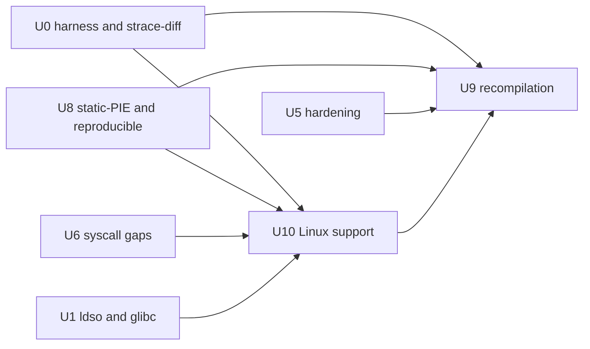

# AzamiOS Static Linking, Static Recompilation and Linux Support Plan (for Codex)

> **Date:** 2026-10-11. **Extends:** [`USERSPACE_IMPROVEMENT_PLAN.md`](USERSPACE_IMPROVEMENT_PLAN.md) (U0–U7). Task IDs continue as **U8–U10**; U0 harness, U1 loader, U5 hardening and U6 syscall work are referenced by number.
> **Also see:** [`CODEX_EXECUTION_PLAN.md`](CODEX_EXECUTION_PLAN.md) (conventions, gates), [`LINUX-BINARIES.md`](LINUX-BINARIES.md), [`TOOLCHAIN.md`](TOOLCHAIN.md).
> **Standard (`AGENTS.md`):** complete implementations only; no placeholder lifters, no fake-success paths; unsupported input must fail loudly with a precise diagnostic. Never touch `hdd.img`.
> Each workstream lists skills (`.agents/skills/<name>/SKILL.md`) to read first.

> [!NOTE]
> "Static recompilation" is used in two senses here. **U8** covers building everything as static / static-PIE from *source* (what the current ports already do, hardened and made reproducible). **U9** covers *binary-to-binary* static recompilation: lifting an existing Linux x86-64 ELF to LLVM IR and compiling it again, for binaries without source. If only one meaning was intended, drop the other workstream; they are independent.

---

## 0. Baseline (verified 2026-10-11)

| Area | State | Consequence |
| :--- | :--- | :--- |
| Ports build | `tools/linux/Makefile` builds BusyBox and probes with `musl-gcc -static`; ports are static musl (`LINUX-BINARIES.md`: "the static case is the one that is exercised") | Static is the primary, tested path. Static-PIE and RELRO are not yet in the flags |
| Native toolchain | `docs/TOOLCHAIN.md`: every on-image native binary is static against native `libc.a`; `tcc -static` required | No dynamic default; keep that rule explicit |
| Dynamic loader | works for musl and native test objects; GNU hash/versioning/TLS GD/RELRO missing (U1) | Static-PIE self-relocation does not need ldso, but dynamic recompiled output would |
| glibc | "unexercised" (`LINUX-BINARIES.md:183`); `rseq` is ENOSYS | Static glibc is out of scope until U1.7/U6 `rseq` |
| LLVM / lifters on host | **`clang`, `llvm-config`, `opt`, `llc`, `llvm-mc`, `lli`, `remill-lift`, `rev.ng` are not installed** | U9 must start with reproducible toolchain provisioning; nothing can be assumed |
| Linux compat probes | `azami-*-probe` suite, `abi-probe` 121/121, strace-gnu, perf shipped | Reuse as the oracle for U9 and as the base for U10 |

---

## U8. Static and Static-PIE Builds from Source

**Skills:** `linkers-lto`, `binary-hardening`, `elf-inspection`, `cross-gcc`, `build-acceleration`

| # | Task | Details | Verify |
| :- | :--- | :--- | :--- |
| U8.1 | Static-PIE loading | Verify `kernel/sched/elf.c` loads `ET_DYN` with **no `PT_INTERP`** at a randomised bias, passes `AT_BASE=0`, correct `AT_PHDR/AT_PHENT/AT_PHNUM/AT_ENTRY`, and leaves `_DYNAMIC` relocatable by the program's own start code (musl `_dlstart`). Add a probe built with `-static-pie` | Probe runs; 64 execs give 64 distinct load bases (shares the U5.2 entropy test); `readelf -h` shows `DYN`, `readelf -l` shows no `INTERP` |
| U8.2 | Flip ports to static-PIE + RELRO | Per-recipe flags `-static-pie -fPIE -Wl,-z,relro,-z,now,-z,noexecstack` where the port builds; keep a per-port opt-out list with the reason (e.g. tcc, nasm text relocs) in `tools/linux/ports/static-exceptions.list` | `scripts/checksec.sh` (U5.3) over `out/bin`: every non-exempt binary is PIE + full RELRO + NX; port matrix (U0.1) still 0 regressions |
| U8.3 | Native `libc.a` slimming | `-ffunction-sections -fdata-sections` for `userland/libc`, link with `--gc-sections`, optional thin-LTO build variant, one archive member per symbol group so static links pull only what they use. Track per-binary size in `docs/U8_SIZE_BASELINE.md` | Size table before/after; hello-world static binary shrinks; abi/smoke gates unchanged |
| U8.4 | Static `dlopen` policy | Native libc static `dlopen` currently reports "no dynamic linker present" (`dlfcn.c`). Keep that honest error; document it. Do not emulate it with a fake loader | Probe asserts `dlopen` returns `NULL` and a meaningful `dlerror` in a static binary |
| U8.5 | Reproducible builds | `SOURCE_DATE_EPOCH`, `-ffile-prefix-map=$(CURDIR)=.`, `-Wl,--build-id=sha1`, sorted archive members (`ar D`), no timestamps in generated headers. `scripts/repro-check.sh <target>` builds twice in different directories and compares SHA-256 | Core ports (busybox, toybox, dash, lua, sqlite3, xz, zstd) bit-identical across two builds; non-reproducible ones listed with cause |
| U8.6 | Language-runtime static builds | Add pinned **Go** (`CGO_ENABLED=0`) and **Rust** (`x86_64-unknown-linux-musl`, `-C target-feature=+crt-static`) hello/stress programs. They stress `clone`, `futex`, `sigaltstack`, `epoll`, `mmap` hints, `getrandom`, `sched_getaffinity` | Goroutine stress (10k goroutines, timers, channels), Rust threads + `std::net` loopback, in the port matrix |
| U8.7 | Static glibc | **Not recommended** (NSS, `iconv`, `dlopen` need shared glibc). Record this decision in `LINUX-BINARIES.md`; revisit only after U1.7 | Doc updated |

---

## U9. Static Binary Recompilation (lift → IR → native)

**Skills:** `llvm-ir-and-passes`, `llvm`, `code-generation-and-backends`, `reverse-engineering`, `elf-inspection`, `assembly-x86`, `abi-and-calling-conventions`, `dwarf-debug-format`, `fuzzing`

Goal: take a **statically linked Linux x86-64 ELF without source**, produce a new AzamiOS ELF whose observable behaviour is the same, with optional hardening or optimisation applied. AzamiOS already executes Linux binaries natively, so recompilation is *not* needed for compatibility; its value is (a) retrofitting hardening, (b) optimisation and coverage instrumentation of binary-only programs, (c) retargeting once non-x86 ports exist, (d) removing runtime dependence on a JIT/translator.

### Design decisions (fixed up front)

1. **Static, whole-program, fail-closed.** Only statically linked, non-self-modifying ELF is accepted. Any construct the lifter cannot prove (unresolved indirect jump, unlifted instruction, writable+executable segment, `int 0x80`, far control transfer) aborts with `file:vaddr: reason`. A `--allow-unlifted` flag may emit a diagnosed trap, and the output is then marked unverified in its `.note.azami.recomp` section. No silent fallbacks.
2. **Lifter:** reuse an existing, maintained lifter rather than writing instruction semantics from scratch. Primary candidate **remill** (instruction semantics to LLVM IR) with a thin in-repo driver; alternative **llvm-mctoll**, **rev.ng**. Choose by running U9.2's corpus; record the decision and rejected options in `docs/U9_LIFTER_SELECTION.md`.
3. **Memory image preserved:** original `.text/.rodata/.data/.bss` placed at their **original virtual addresses** (linker script `--section-start`, `ET_EXEC`) so pointer equality, jump tables and stored code addresses keep meaning. Lifted functions are reachable through a generated `orig_va -> lifted_fn` table for indirect calls and returns-via-stack.
4. **Register/flag state in a struct passed by pointer** (as remill does); `opt` passes promote it to SSA. Calling convention is inferred only for optimisation; the baseline output is semantically exact.
5. **Syscalls need no translation** (same Linux ABI). `syscall` lifts to a runtime intrinsic that executes the real `syscall` with the lifted register values. `clone`/`fork`/`vfork`/`rt_sigreturn`/`execve` get dedicated stubs because they change the stack or the instruction pointer.

### Tasks

| # | Task | Details | Verify |
| :- | :--- | :--- | :--- |
| U9.0 | Toolchain provisioning | `tools/recomp/` with pinned, checksum-verified LLVM (≥ 18) and chosen lifter fetched/built by `make -C tools/recomp toolchain`; extend `scripts/doctor.sh` / `scripts/devenv.sh` to report them; no system install required | `make -C tools/recomp toolchain` on a clean checkout; `doctor.sh` shows versions |
| U9.1 | Corpus and oracle | Corpus = static musl binaries already in `tools/linux/out/bin` (`lua`, `sqlite3`, `xz`, `zstd`, `bzip2`, busybox applets, `dash`) plus purpose-built probes. Oracle = original binary on AzamiOS: stdout/stderr, exit status, **strace-diff** (U0.2) syscall sequence modulo addresses | `tests/recomp/corpus.list` with command + expected output |
| U9.2 | ELF front end | Parse headers/sections/segments/symbols; function boundaries from `.symtab`, `.eh_frame`, entry point and call targets; refuse stripped binaries unless `.eh_frame` gives full coverage. Output a JSON image description (`tools/recomp/image.json`) used by later stages | Unit tests on hand-built ELFs: stripped, PIE (rejected with message), RWX segment (rejected) |
| U9.3 | CFG and indirect-jump recovery | Disassemble reachable code; recover **jump tables** (bounded index + table load pattern) with explicit bounds; resolve indirect calls against the symbol/`.init_array`/relocation-derived function set; unresolved → fail-closed diagnostic with address | Switch-heavy test program; each jump table recovered and the recovered target count equals the compiler's `.rodata` table size |
| U9.4 | Lift and link | Lift each block to IR; generate `lifted.ll`, address table, entry stub setting up `%rsp`/`%fs` exactly as the kernel delivered them; link with `ld.lld`/`ld` at original addresses. TLS: preserve `%fs` base handling (`arch_prctl`) and the original TLS image | `hello` (musl static) recompiles and runs; `lua -e 'print(6*7)'` prints 42 |
| U9.5 | Instruction coverage | Track every distinct opcode in the corpus; **per-instruction differential tests**: `tests/recomp/insn/` generated cases run natively (snapshot registers/flags/memory), lifted function run on the same input, state compared bit-exact (including flags and `MXCSR` where defined). Cover integer, flags, string ops with `rep`, SSE/SSE2 (musl), x87 as needed, `cpuid`/`rdtsc`/`xgetbv` as runtime intrinsics. Undefined-flag behaviour documented per instruction | 100 % of corpus opcodes covered; coverage matrix in `docs/U9_INSN_COVERAGE.md` |
| U9.6 | Signals and non-local control flow | `rt_sigaction` handlers run lifted code; `rt_sigreturn` restorer lifted correctly; `setjmp/longjmp` (musl asm) and `__unwind` through `.eh_frame` verified; `vfork` shared-stack semantics preserved | Signal, `setjmp`, thread, `fork`, `vfork` probes behave identically to the original |
| U9.7 | Threads | `clone(CLONE_VM\|CLONE_THREAD…)` entry stub: child starts in lifted code on the new stack with `%rax=0`; `futex`/robust list pass through; atomics (`lock`-prefixed, `cmpxchg`, `xchg`) lifted to LLVM atomic ops with correct ordering (seq_cst) | Multi-threaded probe and `sqlite3` threaded test identical results; ThreadSanitizer-clean runtime stubs on the host |
| U9.8 | Verification gate | `tests/recomp/run.sh`: for each corpus row run original and recompiled on AzamiOS, compare output + strace-diff; any difference fails. Add the script as **Gate 4** after Gate 3 | 0 diffs across corpus; negative test: a deliberately mislifted instruction is caught |
| U9.9 | Use case: hardening retrofit | Optional passes on the IR: control-flow integrity on indirect calls using the recovered function-address set (`__cfi`-style check against the table), software shadow stack for lifted `call/ret`, bounds on recovered jump tables. Measure overhead with `tests/bench` | Exploit-style probe (overwrite return address) aborts in recompiled build, succeeds in original; overhead recorded |
| U9.10 | Use case: optimisation and instrumentation | `opt -O2`/PGO on lifted IR where the state struct is promoted; coverage instrumentation (SanitizerCoverage `trace-pc-guard`) so binary-only static ports can be fuzzed with libFuzzer/AFL++ (ties to U5.6). Compare to the original on `bench_*` | Speed-up or neutral result documented honestly; fuzz target built from a binary-only port finds a seeded bug |
| U9.11 | Use case: retargeting | After an aarch64/riscv64 userspace exists, emit the same IR for that triple. Until then keep the IR target-independent and test only through the host's `qemu-user` as the oracle | Gated on an arch port; not implemented speculatively |
| U9.12 | Policy | Only recompile binaries whose license allows it; each corpus entry records its license and source URL/SHA-256; recompiled output carries `.note.azami.recomp` (tool version, input SHA-256, unlifted-instruction count) | Note present and parsed by `scripts/checksec.sh` |

> [!IMPORTANT]
> Do **not** claim U9 works on dynamically linked, PIE, JIT or self-modifying binaries. Reject them with a clear message; extending coverage is separate follow-up work with its own corpus.

---

## U10. Wider Linux Support

**Skills:** `linux-kernel-architecture`, `kernel-internals`, `containers-internals`, `kernel-testing`, `qemu-for-kernel-development`, `strace-ltrace`

| # | Task | Details | Verify |
| :- | :--- | :--- | :--- |
| U10.1 | `/proc` and `/sys` fidelity | Capture goldens from a real Linux host into `tests/semantics/golden/` and diff structurally: `/proc/self/{maps,smaps,smaps_rollup,status,stat,statm,auxv,environ,limits,cgroup,mountinfo,fdinfo/*,exe,cwd,task/*}`, `/proc/{cpuinfo,meminfo,loadavg,uptime,version,filesystems,sys/kernel/*,sys/vm/*}`, `/sys/devices/system/cpu/*`, `/sys/class/*` | Format tests (field presence/order/units) pass; `ps`, `top`, `free`, `lscpu` ports show correct data |
| U10.2 | Distro-style root | FHS tree, `/etc/os-release`, `passwd/group/shadow`, `nsswitch`-free musl lookups, `devtmpfs` + `/dev/{null,zero,random,urandom,tty,ptmx,pts/*,shm}`, `getty/login` on a pty, BusyBox `init` + `inittab`, `mdev` as udev replacement | Boot to login on serial; `su`, `login`, `sh` job control work |
| U10.3 | Alpine userland unmodified | Pinned Alpine `minirootfs` (musl) unpacked to a disposable ext2 image; `chroot`/`pivot_root` into it; run `apk` (static `apk.static`) against a **local pinned mirror** (no network in tests) to install and run packages. Highest-value, lowest-risk Linux-distro target because it is musl | Alpine `/bin/busybox`, `apk info`, `apk add` of a local package, then run it |
| U10.4 | Foreign-arch emulation | Port `qemu-user` static (aarch64, riscv64) to run foreign Linux binaries. Requires `MAP_FIXED_NOREPLACE`, huge `PROT_NONE` reservations, signal frame correctness, `/proc/self/exe`/`auxv`, `futex`, `clone` | `qemu-aarch64 hello-aarch64` runs; oracle = same binary on the Linux host |
| U10.5 | Container runtime | `crun` (small, C) with OCI bundles on top of the existing UTS/PID/mount namespaces; fill gaps found by `IMPROVEMENT_PLAN.md` W3.8 (user/net/ipc/cgroup namespaces, cgroup v2 controllers needed by `crun`). Report each missing piece as a syscall/namespace task, never fake it | `crun run` of an Alpine bundle prints its hostname and sees its own PID 1 |
| U10.6 | Package managers on the image | After U4 wave 1: `apk` (U10.3) and a documented `make install DESTDIR` flow; `docs/PACKAGES.md` updated with provenance and checksums | Install, run, remove, verify files gone |
| U10.7 | Compatibility suites | LTP `syscalls` subset (build with musl, run through the port matrix; keep an **expected-failure list** with reasons), glibc/musl `libc-test` (U0.4), kselftest-style semantics probes in `tests/semantics`. Generate `docs/LINUX_COMPAT_STATUS.md` from the results (pass/fail/skip, not hand-edited) | CI-style script prints pass-rate; regressions fail Gate 3 |
| U10.8 | Compat telemetry | Extend U0.3: besides `/proc/azami/enosys`, count `-EINVAL`/`-EOPNOTSUPP` returned for *unknown flags/commands* per syscall in `/proc/azami/compat`; rank by frequency in the matrix to drive U6 | Probe passing an unknown flag increments the counter |
| U10.9 | glibc dynamic userland | Continue U1.7 (Debian `ld-linux`, `rseq`); after it works add Debian `coreutils`, `bash`, `python3` rows. Keep identification of the exact loader/libc payload (SHA-256 recorded) | See U1.7 |

---

## 8. Order and dependencies



Suggested sequence: **U8.1 → U8.2 → U8.5 → U9.0 → U9.1 → U9.2 → U9.3 → U9.4 → U9.5 → U9.8** (first working recompile), in parallel **U10.1 → U10.3 → U10.7 → U10.8**. Defer U9.9–U9.11 until U9.8 is green.

## 9. Gates

Everything in `USERSPACE_IMPROVEMENT_PLAN.md §8` stays mandatory (build with zero new warnings, `./scripts/linux-test.sh`, `./tests/boot/matrix.sh`, busybox smoke, ports matrix). Additions:

```bash
./scripts/repro-check.sh busybox            # U8.5: bit-identical twice-built output
./scripts/checksec.sh tools/linux/out/bin   # U8.2/U5.3: PIE + RELRO + NX (minus exceptions list)
./tests/recomp/run.sh                       # Gate 4 (U9.8): 0 differences original vs recompiled
```

Report skipped gates (no KVM, tool absent) as skipped. Never claim a pass that did not run.

## 10. Exit criteria

- All shipped ports build static-PIE with full RELRO or are listed with a reason; the core set is bit-reproducible.
- Go and Rust static binaries pass their stress rows.
- Static musl corpus binaries lift, recompile, and match the original (output, exit status, syscall trace) with 0 diffs; instruction coverage matrix is complete for the corpus; unsupported inputs are rejected with diagnostics.
- A hardening retrofit (U9.9) demonstrably blocks a return-address overwrite in a binary-only program.
- Alpine `apk` installs and runs a local package; `crun` runs an Alpine OCI bundle; `qemu-user` runs an aarch64 hello.
- `docs/LINUX_COMPAT_STATUS.md` is generated from real suite results, and `/proc/azami/{enosys,compat}` drive the U6 priority list.

